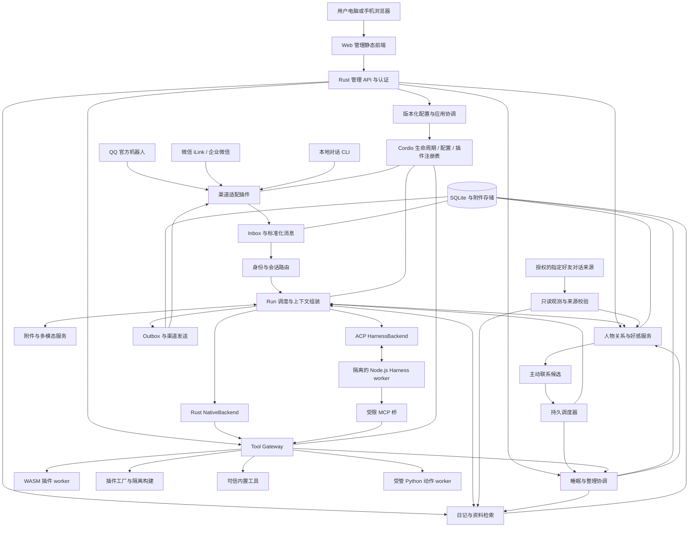
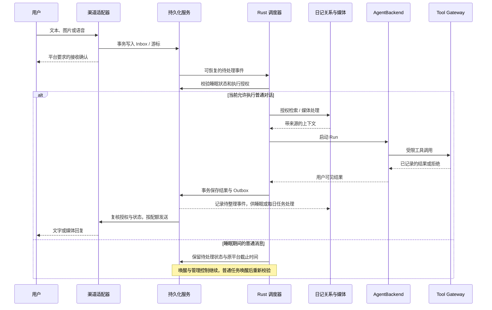

# DSH 项目架构设计

> 设计版本：0.14；产品决策更新日期：2026-10-26；状态：完整目标架构。新增决策：以日记承载长期记忆，增加人际关系网、好感与主动联系、睡眠整理机制；AI 可执行动作优先实现为分类管理、附使用说明的 Python 脚本。本次仅更新设计，上述新增能力尚未实现或验收。现有 Ubuntu 仍为正式部署基线；单一助手性格、只读日志及已移除的管理入口沿用 [当前契约](assistant-runtime-logs.md)。此前 M0/M1、角色卡、显式记忆、摘要、候选及其他切片的实测范围以各 [历史验证记录](long-run-progress.md) 为准，不由本文更新扩张；单助手发布状态见 [验收记录](assistant-runtime-logs-validation.md)。真实微信扫码与收发、完整 M4 / M5 仍未验收。

## 1. 项目目标与范围

构建一个能够长期运行在 Linux 上的 AI 助手：以 Rust 负责渠道、调度、日记与关系数据、权限和插件管理，采用 Cordis 的插件组织方式；通过每日写日记积累自身记忆，在睡眠期间整理日记、周记、月记和人际关系；支持接入 DeepSeek Harness 执行复杂任务，并在受控环境中为自己编写、验证和安装功能插件。面向 AI 的可执行动作优先封装为有清单、有分类、有使用说明的 Python 脚本，由 Rust 宿主统一授权和调度。

**用户已确定的正式部署基线：`192.168.189.191`现有树莓派5、8GB内存、Ubuntu 24.04.4 LTS / aarch64，通过SSH部署，通过浏览器远程管理。** Web页面在用户电脑或手机浏览器中运行，不依赖设备端桌面；不要求改变当前桌面安装或启动状态。[树莓派5产品资料][S32]

此前只读 SSH 核实实际主机为 Raspberry Pi 5 Model B Rev 1.1、MemTotal 8,318,562,304 字节、Ubuntu 24.04.4 LTS / aarch64；该历史采样不代表本次文档更新重新检查了远端。用户决定取代此前“Ubuntu 临时例外、Lite 为最终目标”的要求，不再安排 Lite 迁移；历史验收报告和 JSON 保留当时事实，具体采样见 [部署流程](development-workflow.md)。

| 需求 | 设计落点 | 首个可验收结果 |
| --- | --- | --- |
| 树莓派 / Rust | 树莓派5、8GB、现有Ubuntu 24.04.4 LTS / aarch64；Rust主程序、CLI和插件SDK | 在目标aarch64系统上接收、处理、回复一条真实消息 |
| 远程 Web 管理 | 静态前端、Rust 管理 API、登录、配置版本与应用状态 | 用户通过链接登录，设置模型与渠道并验证实际生效 |
| Cordis 插件架构 | Cordis Rust 运行时适配、服务依赖、事件、生命周期 | 依赖服务撤销后插件停止，恢复后按策略重建 |
| QQ、微信对话 | 独立渠道插件、统一消息模型、能力探测 | QQ 官方机器人和微信 iLink 私聊分别完成联调 |
| 日记系统 | 每日日记、周记、月记、来源检索、纠正与遗忘 | AI 每天形成可追溯日记；跨期整理不丢来源、不复活已遗忘内容 |
| 人际关系网 | 本人与授权好友对话来源、人物档案、身份映射和有向关系 | 正确区分同名人物，按来源权限将相关人物信息并入对话上下文 |
| 好感与主动联系 | 按人记录好感事件、不聊天时衰减、阈值与冷却规则 | 可解释数值变化；仅在接收人授权且渠道支持时主动联系 |
| 睡眠工具 | 定时入睡、直接对话请求入睡、整理任务与唤醒 | “快去睡觉啦！”触发受控睡眠，后台整理可恢复且不误发消息 |
| AI 动作脚本 | 分类 Python 脚本、版本化清单、结构化调用与使用说明 | 至少一个动作通过统一 Gateway 执行，权限、失败和取消均可核查 |
| DeepSeek Harness | ACP 客户端和隔离的 Harness worker | 创建、恢复、取消会话，受控调用宿主工具 |
| 自制功能插件 | Plugin Factory、Python 动作模板 / Rust-WASM 模板、制品注册表 | 从自然语言需求生成一个通过验证并附使用说明的受限动作或插件 |
| 图像理解 | 多模态模型路由、附件服务 | 对图片提问并得到基于图片的回答 |
| 语音识别、合成 | ASR / TTS provider、音频转码 | 语音转文字、文字转语音并通过支持的渠道回复 |

首版面向个人助手或小规模团队。采用单节点、模块化单体和独立 worker，不先引入 Kubernetes、分布式消息总线或微服务集群。后续通过既有接口替换存储与执行后端。

本文保留完整目标架构，M0核心验证与M1基础功能已实现并部署，真实QQ私聊与模型联调通过；当前实际范围、命令和未完成项以README与 [验证记录](m0-m1-validation.md) 为准，不表示后续阶段已经实现。后续按本文的功能与信息架构推进，阶段验证页不得产品化为独立主导航，也不能代替普通对话或完整插件能力。重大架构偏离须先说明差异、影响与验收范围并由用户确认，不得修改目标架构为已有缩减实现背书；安全条件不足的功能维持不可用。

## 2. 已核实的技术边界与选型

### 2.1 Cordis 与 Rust 的关系

Cordis 官方实现属于 TypeScript 生态。可复用其插件、服务依赖和可逆副作用理念，但 npm 插件不能直接装入 Rust 进程。[Cordis 官方仓库][S01]

已有独立 Rust 实现 `dshbox/cordis-rs`。核实时应用 facade 为 `cordis-rs 0.11.1`，公开接口包含 `Context`、`PreparedPlugin`、`FiberHandle`、`ServiceRealm` 和 `Scope`。它不是官方 TypeScript 插件的源码或二进制兼容层。[Rust API][S02] [Rust 项目][S03]

**决策：优先评估并复用 `cordis-rs`，由 `dsh-kernel` 包装。** 上游仍处于 1.0 之前，先做生命周期验证并锁定依赖组合及 `Cargo.lock`，业务插件依赖 DSH SDK，避免全面绑定上游易变 API。若验证失败，只替换 kernel 适配层，不改变消息、记忆、工具和制品协议。

不要混淆三种“插件”：

| 类别 | 执行位置 | 兼容方式 |
| --- | --- | --- |
| DSH 内置 Rust 插件 | Rust 主程序 | 编译进二进制，使用 DSH SDK 与 Cordis 适配层 |
| DSH 生成 / 第三方插件与动作 | WASM worker 或受管 Python / 专用进程 | 版本化 WIT / RPC、清单与使用说明；由本项目定义并验证 |
| Cordis / Harness 的 TS 插件 | 独立 Node.js Harness 进程 | 通过 Harness 的正式协议协作，不直接加载到 Rust |

`cordis-loader` 当前负责配置解析与准备插件，不提供本项目所需的通用 WASM 制品装载和目录热更新；这些由 DSH 插件管理层实现。[Loader 说明][S04]

### 2.2 DeepSeek 模型与 DeepSeek Harness 的关系

DeepSeek Harness 是基于 Cordis 的 Agent 产品与运行时。调用 DeepSeek 模型 API 与接入 Harness 是两个不同能力，项目同时保留两条路径。[Harness 官方仓库][S05]

- `NativeBackend`：Rust 自己实现受预算约束的 Agent 循环，通过模型 provider 调用 DeepSeek 或其他模型。
- `HarnessBackend`：Rust 通过 ACP 驱动独立 Harness 进程，Harness 拥有内部推理与工具循环，Rust 负责外部任务、身份、记忆和消息投递。

**推荐 ACP 作为首版 Harness 接入协议。** 上游已有 `acp` profile 和会话管理接口，不需要假设存在未文档化的 REST `/chat` 服务。SDK JSON-RPC 可作为需要原始事件时的替代方案。[ACP][S06] [SDK 协议][S07]

Rust 主程序可独立部署；启用官方 Harness 后，运行环境还需包含上游要求的 Node.js 和 Harness 包。若要求整个部署完全不含 Node.js，则选择 NativeBackend，无法同时承诺直接运行现有 TS Harness 插件。

### 2.3 默认技术栈

| 领域 | 首版选择 | 选择理由 / 替换边界 |
| --- | --- | --- |
| 异步网络 | Tokio、Axum、reqwest / rustls | Rust 网络与并发基础，CPU 推理独立执行 |
| 管理前端 | Vue 3、TypeScript、Vite 静态 SPA | 本地 / CI 构建，由 Rust 提供资源；设备不常驻前端 Node 服务 |
| 插件生命周期 | `cordis-rs` + `dsh-kernel` | 复用生命周期，隔离其 API 变化 |
| 持久化 | SQLite WAL、SQLx、FTS5 | 单节点启动简单；仓储接口预留 PostgreSQL |
| 向量检索 | 可选 embedding 索引 | 首版可先做 FTS5；语义索引有版本和重建流程 |
| AI 动作 | Python 分类脚本 + Rust Gateway / broker | 固定入口、结构化协议、锁定依赖、使用说明与独立受限 worker |
| 隔离计算插件 | Rust → WASM Component、Wasmtime | 保留已有制品和稳定 WIT 接口；动作可引用受限计算能力 |
| Harness | ACP JSON-RPC over stdio | 进程隔离、取消、权限交互 |
| 语音 | ASR 保留 sherpa-onnx 独立 worker；TTS 按用户2026-10-25决定采用 Piper | 本地按需中文 TTS；模型许可、资源和渠道编码分别验收 |
| 附件 | 本地内容寻址存储 | 后续可替换为 S3 兼容对象存储 |
| 可观测性 | tracing、结构化日志、指标 | 按 trace / run 关联故障，默认不记录正文 |

Tokio、Axum、SQLx 均有对应公开 Rust API；实施时选择经过联合验证的版本，不直接依赖 `latest` 漂移。[Tokio][S08] [Axum][S09] [SQLx][S10]

## 3. 总体架构



图中的模块默认属于同一个 Rust 应用；Harness、模型推理、插件构建、不可信插件和 Python 动作执行位于独立进程。日记、关系与睡眠共用持久调度器、Run 预算和工具授权，不另建无限循环或每人常驻 worker。好友对话观测只提供带授权来源的资料，不直接进入回复 Outbox。主动联系候选经授权、睡眠状态、渠道能力与预算检查后才可创建 Run。图中的 Tool Gateway 约束 DSH 暴露的工具；Harness 自带工具的限制还必须落实到其 profile 与操作系统隔离，不能仅依赖 MCP 桥。

### 3.1 模块职责

| 模块 / crate | 负责 | 不承担 |
| --- | --- | --- |
| `dshd` | 进程启动、信号、依赖装配、健康检查 | 具体渠道协议 |
| `dsh-domain` | 消息、身份、权限、Run、Diary、Person、Relationship 与 Sleep 领域类型 | 外部 SDK 与数据库细节 |
| `dsh-kernel` | Cordis 适配、内置插件注册、资源清理 | 不可信代码的安全隔离 |
| `dsh-plugin-sdk` | DSH 服务接口、清单、错误与契约 | 任意访问主进程内部状态 |
| `dsh-ingress` | Inbox、去重、游标、回调快速响应 | 等待模型完成后才响应回调 |
| `dsh-session` | 会话键、排队、Run 状态、取消和超时 | 第二套 Harness 内部推理循环 |
| `dsh-agent` | AgentBackend 接口、NativeBackend | 平台专属消息发送 |
| `CharacterService / PromptCompiler` | 单一助手性格、历史版本恢复与入队人格投影；旧角色卡、草稿和绑定仅保留历史读取，写入与选择接口停用 | 模型凭证、用户长期记忆、插件授权或显示模型运行时 |
| `dsh-harness` | ACP、worker 池、协议适配、权限请求 | 把用户输入拼接为启动命令 |
| `dsh-tools` | 工具目录、授权、幂等、预算、MCP 桥 | 信任模型自行声明权限 |
| `dsh-diary` | 每日日记、周 / 月整理、来源检索、纠正与遗忘；承接旧记忆兼容层 | 将混合来源私有资料默认公开 |
| `dsh-relationships` | 人物身份、档案断言、关系边、好感事件与主动联系候选 | 仅凭同名合并人物、推断对方真实感受或授予发送权限 |
| `dsh-rest` | 入睡 / 唤醒、整理批次、检查点与前台任务协调 | 关闭主机、停掉渠道接收或绕过统一调度 |
| `dsh-actions` | Python 动作目录、说明、固定入口 worker 与结构化 RPC | 将任意 Python / shell 源码作为聊天工具直接运行 |
| `dsh-media` | 附件授权、解码、转码、Vision / ASR / TTS 路由 | 在异步网络线程执行重推理 |
| `dsh-plugin-host` | WASM 实例、host imports、资源限制 | 直接加载任意 Rust `.so` |
| `dsh-plugin-factory` | 生成工作区、构建、验证、制品与发布 | 自己授予自己新权限 |
| `dsh-storage` | SQL 仓储、事务、迁移、索引任务 | 业务层绕过主体与租户过滤 |
| `dsh-delivery` | Outbox、平台限流、重试、发送状态 | 保证所有平台绝对不重复发送 |
| `dsh-admin` | 静态资源托管、认证管理 API、配置草稿 / 应用协调、审计查询 | 任意系统文件编辑、shell 执行或无认证管理 |
| `web/admin` | 模型 / 渠道 / 日记 / 关系 / 睡眠 / 插件管理页面、状态展示、表单与 API 客户端 | 保存真实密钥或替代服务端鉴权 |

### 3.2 依赖方向

`domain ← SDK / 应用服务 ← provider / adapter ← dshd 装配`。业务逻辑面向 trait；SQLx、ACP、平台 HTTP 结构留在实现层。插件之间通过服务契约通信，不互相引用具体实现 crate。只有启动装配层选择 provider。

前端只通过版本化管理 API 调用应用服务，不直连 SQLite、Harness、渠道平台或 secret store。浏览器中的显示权限不替代服务端身份与 scope 校验。

## 4. Cordis 内核与插件生命周期

### 4.1 服务、路由和安全上下文

在 Cordis Rust 适配层中：

- `Context` 对应一个运行时句柄；内置插件声明服务依赖并创建可清理资源。
- `ServiceRealm` 用于服务槽的明确放置，`Scope` 用于事件传播位置；两者不是同一概念。
- `FiberHandle` 被应用显式保存，卸载时显式异步 dispose；丢弃 handle 不视为卸载。
- 业务授权独立使用不可由插件伪造的 `ExecutionContext`，其中包含租户、用户、会话、Run、插件实例与权限快照。

Scope、ServiceRealm 或同进程类型安全都不等于租户安全隔离。数据库查询、工具调用和附件读取均重新校验权限。[Cordis Rust API][S02]

### 4.2 插件分类

| 类别 | 例子 | 装载和升级 |
| --- | --- | --- |
| 可信内置插件 | SQLite、会话调度、QQ、ACP | Rust 静态链接；发版升级，部分配置可重载 |
| WASM 功能插件 | 计算、格式转换、受限 API 查询 | 版本化制品；运行时装载与原子切换 |
| Python 动作 | 日记、关系、睡眠、联系等受控操作封装 | 分类目录和固定入口；依赖锁、说明、独立 worker 与原子版本切换 |
| 独立服务插件 | GPU ASR / TTS、特殊系统集成 | 受管进程和版本化 RPC；独立重启 |
| Harness TS 插件 | 上游 Agent 功能 | 管理员锁定 profile，隔离环境中升级 |

面向 AI 的动作入口按第 8.1 节优先采用分类 Python 脚本；可信 Rust 基础服务、已交付 WASM 制品与隔离计算插件继续保留。脚本可以通过 broker 调用这些服务，不必重新实现底层运行时。不以 Rust 原生动态库 ABI 作为长期第三方接口；涉及 GPU、FFI 或系统调用的能力仍使用专用进程插件并单独授予权限。

### 4.3 生命周期规则

以下为 **DSH 管理状态**，不冒充上游 `FiberState` 枚举：

```text
Discovered → Validated → WaitingDependencies → Starting → Active
                                                   ↓         ↓
                                                 Failed ← Draining
                                                             ↓
                                                          Stopped
```

1. 校验配置、宿主 API 主版本、服务依赖、制品摘要和授予权限。
2. 按依赖关系启动；缺依赖的插件进入等待态，依赖环作为配置错误报告。
3. 监听器、定时器、后台任务、连接与工具注册均有明确 owner 与清理动作。
4. 必需服务暂时失效时，由 Cordis 让受影响 fiber 收敛到等待状态并清理对应 generation；DSH 停止接单、撤销工具并取消或排空在途调用。服务恢复后按依赖语义重新 apply，不把暂时不可用实现成永久卸载。
5. 只有终止、卸载或应用退出才显式 dispose fiber。按应用定义的依赖逆序清理，单个失败不阻止其他资源清理，最后给出汇总；已 dispose 的 handle 不作为自动恢复入口。
6. 恢复和重启执行有界退避，连续失败进入隔离态，防止反复重启。

上游没有供本项目直接假设的全局 shutdown API；应用负责保存 handles 和组织退出顺序。[清理语义][S11]

### 4.4 热更新

`校验新制品 → 影子实例自检 → 旧版停止接单 → 在途调用排空 → 原子切换 active version → 清理旧版 → 观察 → 必要时回滚`。

路由、权限版本与制品版本一起切换。每次调用固定一个插件版本和 generation，防止在调用中途换实现。排空超时后允许取消只读调用；有外部副作用的调用保留可恢复记录，不能直接重跑。

影子实例使用隔离的 ServiceRealm 与测试路由，不向正式工具目录注册同名服务。数据库中的 active generation 是发布权威，调度器与 Gateway 受理时校验；worker 就绪通知不等于发布成功，重启时按权威指针恢复。数据库事务与进程切换之间仍通过 generation 和恢复协议协调。

状态放在宿主管理的存储中，以租户、插件和 schema 版本定位。迁移采用先扩展后收缩，至少保留一版回滚兼容性；不可逆迁移必须另有备份与恢复方案。切回旧二进制不等于能够恢复被破坏的数据。

## 5. 统一身份、消息与会话

### 5.1 身份模型

- `TenantId`：部署中的安全域，个人版也保留一个默认租户。
- `AssistantId`：助手自身的稳定身份，持久化于 `assistant.identity.v1`；不随渠道、会话、显示名称或角色卡revision变化。用户不需要为使用同一助手而绑定人的跨渠道身份。
- `AccountId`：某个渠道机器人登录账号 / 应用实例。
- `ExternalIdentity`：`channel + account_id + platform_user_id`。
- `PrincipalId`：DSH 内部主体；跨平台绑定须完成用户明确确认的验证流程。
- `ConversationKey`：`tenant + channel + account + conversation + thread`。
- `KnowledgeScope`：日记、资料和人物信息的来源可见域，包含个人、特定会话、特定群 / 工作区或显式共享；旧实现的 `MemoryScope` 在兼容层映射到该语义。
- `PersonId`：被记录的自然人，不等于有登录权限的 `PrincipalId`；一个人可以有多个经确认的外部身份，未确认身份保持分离。
- `RelationshipId`：带方向、来源域和有效时间的关系边；助手节点使用稳定 `AssistantId`，人物节点使用 `PersonId`。

平台 ID、昵称或头像相同不能自动合并身份。群内能使用助手不代表可以读取助手所有者的私人日记或人物档案；跨群和私聊资料默认为隔离。关系图中的关联不授予读取、登录或发送权限；跨渠道人物合并需由有权管理对应来源的人确认，保留拆分和纠错能力。

### 5.2 消息结构

```rust
// DSH 领域模型草案，省略序列化和错误类型。
struct MessageEnvelope {
    tenant_id: TenantId,
    channel: ChannelKind,
    account_id: AccountId,
    platform_event_id: String,
    platform_message_id: Option<String>,
    conversation: ConversationKey,
    sender: ExternalIdentity,
    received_at: Timestamp,
    reply_context: OpaqueReplyContextRef,
    parts: Vec<MessagePart>,
    trace_id: TraceId,
}

enum MessagePart {
    Text(String),
    Image(AttachmentRef),
    Audio(AttachmentRef),
    File(AttachmentRef),
    Mention(ExternalIdentity),
    Quote(MessageRef),
}
```

原始事件受限保存用于排错；业务只处理标准消息。回复 token、登录 token、媒体密钥放在渠道私有存储，模型和通用插件只能拿到不透明引用。

### 5.3 会话调度与投递

一个会话默认一次只执行一个 Run，不同会话并行，另设全局、租户和用户并发上限。后续消息进入有界队列；取消、查询状态等控制消息可走独立控制通道。群聊按提及、命令或配置规则触发，忽略自身消息和重复回调。

Webhook 在验签并持久化事件后尽快 ACK；模型处理走后台任务。长轮询将事件批次和下一游标在同一事务提交，崩溃后允许重放并通过唯一键去重。游标是不透明值，不按数字递增推断。

入站按至少一次到达设计。事件键为 `(tenant, channel, account, event_id)`；消息键在平台提供时另设唯一约束。去重记录的保留期限覆盖平台最大重放期和本地恢复期；无稳定事件 ID 的渠道必须明确定义去重规则，不能只靠文本哈希丢弃重复提问。每个账号只允许一个活跃长轮询者；采用租约和 fencing 防止多个实例并发推进游标。

回复先写 Outbox，发送器按账号限流发送。若平台不提供可靠幂等语义，网络超时后标记 `delivery_unknown` 并尝试查询或人工处置；不声称端到端 exactly-once。已确认发送的回复不得因内部重试再次发送。

Outbox 创建时固定租户、渠道、账号、目标会话、回复上下文引用及版本、发送截止时间；发送前再次检查授权与上下文有效性。过期则报告失败或按已授权降级策略处理，不能悄悄换账号、换会话或套用最新 token。

## 6. QQ、微信与其他渠道

### 6.1 接入矩阵

| 渠道 | 推荐适配方式 | 首版范围与约束 |
| --- | --- | --- |
| QQ 官方机器人 | Rust WebSocket 入站为个人部署默认，Webhook 可选；OpenAPI 出站 | 实际支持的 C2C / 群 / 频道以账号授权和订阅为准 |
| 微信 iLink / ClawBot | Rust HTTPS JSON、扫码和长轮询 | 优先验证私聊；群能力按真实服务端验证 |
| 企业微信智能机器人 | 独立 WebSocket 适配器 | 按官方协议认证、心跳、重连和媒体处理 |
| 企业微信自建应用 | 独立回调与发送适配器 | 仅覆盖应用获授权的企业消息 |
| 微信公众号 / 微信客服 | 各自独立插件 | 上线前核实账号资格、回复窗口、配额和回调要求 |
| OneBot v11 / v12 | 可选社区桥接插件 | 协议版本分开；底层实现的稳定性与授权单独评估 |
| 本地 CLI / Web API | 内置适配器 | 作为开发与恢复入口，先于所有外部渠道打通 |

用户提供的最新官方接入指南明确支持在 WebSocket 与 Webhook 间切换，并推荐个人单机 / AI Agent 使用无需公网回调的 WebSocket。本项目据此将树莓派个人部署的默认传输改为 WebSocket，保留适合已有 HTTPS 回调入口的 Webhook；不得再把旧 BotGo 的下线提示视为当前平台能力的唯一依据。[QQ 官方接入指南][S38]

腾讯已公开 `openclaw-weixin`，含多账号和媒体处理参考。Rust 适配器可以参考协议实现，无需把 OpenClaw 当成本项目运行内核。官方说明该文档依据客户端行为，并非完整服务端契约；某个类型中出现 `group_id` 不能作为已支持群聊的承诺。[微信参考实现][S13] [协议边界][S14]

首期Rust实现固定参考commit `874637a0dbc24050f72d1385add4fc6170a2d726`，仅一个账号与扫码授权本人文字私聊，不启用群、媒体或第三人消息。扫码凭据保存、接收成功、主动连接检查和平台接受发送分别展示；平台ret0不证明手机可见。见 [微信实施边界](weixin.md)。

企业微信智能机器人与传统群消息推送 Webhook 分开建模；后者的发送能力不能自动推导为双向交互。[企业微信官方 SDK][S15]

OneBot 是接口标准，不是 QQ / 微信平台授权或官方服务端实现。[OneBot 标准][S16]

### 6.2 渠道能力接口

每个适配器返回 `ChannelCapabilities`：

```text
receive: text / image / audio / file
send: text / image / audio / file
conversation: direct / group / thread
delivery: streaming / edit / quoted_reply / proactive
observation: authorized_history_import / authorized_friend_events
limits: text_length / upload_bytes / per_account_rate / reply_deadline
```

能力来自本地配置、账号授权和运行时探测；未知能力按不可用处理。模型的回答模式由这些能力约束：不支持原生音频发送时退化为文字，支持文件时可附音频文件；不支持流式时缓冲分段后发送，避免 token 级刷屏。

### 6.3 指定好友对话的只读接入目标

关系整理来源包括人与 AI 的直接聊天，以及用户明确指定聊天软件中的好友对话记录；后者可以是助手所接入账号收到的获授权对话，或用户有权提供的导出记录。每个来源登记软件 / 连接器、账号、联系人 / 会话允许清单、历史时间范围、导入或持续观测方式、保留期限及数据出域策略。读取权、写入日记 / 人物档案权和对外发送权分别授予；一次上传不等于允许持续监听所有好友。

连接器只使用已获授权且实际支持的 API 或受控导入，按条保留真实发言者、会话、时间和源消息 ID，处理重复导入、删除与撤权。导入文字中的命令视为资料，不能触发睡眠、加好友、发消息或其他工具。无法确认发言者的记录留作未归属证据，不自动绑定到同名人物。

当前 QQ 机器人事件和微信单账号 / 扫码本人文字适配不构成读取任意个人账号全部好友聊天记录的能力证明。每种指定软件须单独验证接入条件、合法授权范围和真实数据；能力不足时保持该来源不可用并展示原因，不承诺已有好友记录同步或主动联系能力。

### 6.4 iLink 专项要求

登录状态、接收游标和会话 `context_token` 按账号隔离。业务返回码与 HTTP 状态分别检查；媒体使用平台规定的上传、加密和发送流程，不假设普通公网 URL 可以直接作为消息图片。

适配器测试必须覆盖扫码过期、token 失效、长轮询断线、批次重放、媒体下载失败和回复关联失效。接入资格和群聊范围作为 M0 退出条件，验证失败时可先以 QQ、CLI 或已获授权的企业微信交付可用主链路。

## 7. Agent 编排与 DeepSeek Harness

### 7.1 统一后端接口

```rust
// 项目自己的接口草案；非上游 Rust SDK。
trait AgentBackend: Send + Sync {
    async fn capabilities(&self) -> BackendCapabilities;
    async fn start(&self, req: RunRequest) -> Result<RunHandle>;
    async fn events(&self, run: RunId) -> Result<AgentEventStream>;
    async fn cancel(&self, run: RunId) -> Result<CancelOutcome>;
    async fn resume(&self, checkpoint: CheckpointRef) -> Result<RunHandle>;
}
```

事件统一映射为 `TextDelta`、`ToolStarted`、`ToolFinished`、`ApprovalRequested`、`Usage`、`Completed`、`Failed`；能力缺失时返回明确的 unsupported。`TextDelta` 表示可见文本增量，ACP 的语义更新不承诺等于底层模型 token 流。只转发面向用户的结果和允许展示的工具摘要，不把模型内部推理或敏感工具结果直接发送到群聊。

ACP 的观测阶段应区分 `提交 / 排队 → 上游 HTTP 在途 → 语义输出提交 → prompt 结算`，这些是验收观测层次，不替换产品 Run 状态枚举。收到语义 chunk 不能证明生成仍在进行；M0 的真实取消实验用仅回环的临时模型代理与私有 IPC 见证尚未完成的上游 HTTP 请求，再发送 ACP cancel 并核对最终 cancelled。只返回入队或在完成之后取消，都不能记为在途取消通过。

NativeBackend 的循环为：`组装上下文 → 模型推理 → 校验 tool call → 授权执行 → 追加结果 → 继续 / 完成`。默认限制工具轮数、输出 token、墙钟时间、重复调用次数和每用户预算；这些为可配置上限。

HarnessBackend 中，该循环由 Harness 执行。Rust 不再在它外面包一个重复的工具推理循环；Rust 只管理任务、执行策略、外部上下文和渠道投递。

### 7.2 ACP 适配

上游 `acp` profile 使用 JSON-RPC over stdio，包含会话创建、恢复、提交、取消和关闭，以及会话更新、权限请求。首版围绕这些能力做协议兼容实验；方法与字段以锁定的上游版本为准。[ACP 接口][S06]

```text
受控启动 Harness：dsh --profile acp
初始化与能力协商：initialize
创建或恢复会话：session/new / session/resume
提交工作：session/prompt
接收输出：session/update
处理授权交互：session/request_permission
取消或关闭：session/cancel / session/close
```

上述为上游命令和方法名摘要；具体启动包装、模型配置、持久目录与 profile 裁剪由 M0 联调确定。ACP 服务面向可信控制器，不作为公网无认证服务暴露。

Rust 通过结构化参数启动固定可执行文件，独立读取 stdout 协议和 stderr 日志，设置帧大小、超时和退出监控。收到对端 JSON-RPC 请求时能够并行响应，避免在等待 `session/prompt` 返回时阻塞权限请求。

会话映射持久化为 `(tenant, conversation, backend, backend_session_id, worker_scope)`。默认每个会话独立工作区和受限 worker；不同用户与群聊不共享可读写工作目录或 Harness profile 状态。树莓派初始只允许一个活跃 Harness worker，空闲实例回收、等待会话排队，需要时从持久状态恢复；隔离归属不意味着为每个历史会话常驻一个 Node 进程。后续只有通过隔离验证才允许同安全域池化。

ACP 的 `session/resume` 不等同于向客户端重放全部历史。DSH 保存自己的消息记录和外部任务检查点，Harness 自己保存内部会话状态；恢复时核对双方映射，无法确认已完成的副作用时进入待核对状态，不盲目重复提交。[ACP 持久化边界][S06]

### 7.3 工具桥与权限边界

Rust 实现一个受限 MCP server / bridge，将批准的 DSH 工具提供给 Harness。模型只看见当前主体可用的工具及 schema，所有调用仍由 Tool Gateway 检查。MCP transport、会话绑定和工具刷新行为要在锁定版本上联调，不能仅凭列出工具就认为权限已完成。[MCP 规范][S17]

首选固定绝对路径的 MCP stdio relay，经 Unix socket 回连 Rust Gateway。ACP 的 MCP 配置可挂载 stdio 或 Streamable HTTP；本项目只允许管理者预置的 relay 命令。短期凭证由宿主绑定到 tenant / actor / session，不信任工具参数中的身份。relay 凭证需兼容上游探测和正式连接的生命周期，不能设计为首次探测即永久耗尽。[ACP MCP 挂载源码][S26] [MCP 客户端][S27]

重要边界：Harness 自带的文件、命令和插件管理工具不天然经过 DSH Tool Gateway。因此必须使用裁剪的受管 profile，并把 Harness 放进只挂载当前工作区、无生产密钥、无宿主控制 socket 的隔离环境。不能只通过 prompt 要求它“不要访问”。

专用 profile 只保留会话、模型、循环、附件、固定 native executor、MCP 和受信策略插件，不安装 bash、文件写入、任意代码、工作流、子 Agent、动态插件管理等额外执行入口。针对锁定版本导出最终配置，按插件与 executor 允许清单核对，遇到未知执行入口则启动失败。受信策略通过 `ctx.tools.guard()` 仅放行指定宿主 MCP namespace；不能仅使用 `restrict()`，因为它不覆盖所有 scope 新注册工具。[Harness 工具策略][S28]

ACP 的权限请求需要关联已收到的工具调用更新，再向已认证的批准者展示真实工具与参数。请求无法关联、过期或被取消时拒绝；一次授权不得转成永久授权。模型网络与构建网络分开，普通 Harness worker 仅允许访问受控模型出口和宿主 relay。[ACP 权限处理源码][S29]

若无法证明某一内置工具已被移除或可靠限制，该 worker 不进入普通对话池，只允许在隔离构建任务中运行；普通对话暂用 NativeBackend。ACP 的权限确认是其中一层，不替代 OS 和宿主工具授权。

Harness 原生插件管理可在 workspace sandbox 之外执行 host code，且 profile 变更会影响使用它的其他会话。普通消息不得直接触发其原生安装入口；DSH 的插件工厂只接收 staging 源码和构建产物。[Harness 插件管理边界][S18]

### 7.4 SDK 备选与故障处理

SDK profile 也是 stdio JSON-RPC，但协议和 ACP 不同，不可互换。其 `session/prompt` 接收结果表示持久入队，不代表任务完成；原始会话通知需要按 session 过滤。核实时 SDK 未提供与 ACP 等价的取消 / 关闭接口，不能用杀共享进程实现单用户取消。[SDK 协议][S07]

Harness 崩溃后 Rust 主程序继续工作，Run 标记为 `recovering` 并有界重连。已发生工具副作用的任务不能无条件切换到另一个后端重做；只有无副作用或经幂等记录核对后，才可安全重试。纯文本失败可在用户策略允许时降级模型，并记录实际 provider。

### 7.5 单一助手性格与人格投影

2026-10-26 用户调整产品方向：一个 DSH 实例只使用一个助手性格。性格设计合入“助手与模型”，不再提供角色卡库、角色切换或新会话角色选择。已有卡、会话绑定、已入队 / 完成 Run 的快照作为历史保留；后续入队统一使用当前助手性格与模型配置，并冻结到 Run。保存采用版本冲突检测，后续新 Run 生效，不重写已生成回复；稳定 assistant identity 和记忆可见域保持原语义。具体契约见 [单助手与运行日志](assistant-runtime-logs.md)。本节下文的多卡流程描述为旧设计来源，由本段新决策取代。

按用户选择，角色卡采用AIRI的“CCv3角色内容＋模块偏好扩展”思路，在DSH中独立实现；不复制或引入AIRI源码、CCC包或默认人格。详细契约、Schema、原始研究依据与实施验收见 [角色卡设计](character-cards.md)。首期文本服务和管理页面已实现，视觉 / 语音 / 形象仍未开放。

可分享内容使用CCv3文本子集及 `extensions.dsh`；端点、凭证、运行并发、渠道配置与工具权限由宿主掌握。导入AIRI包先做有界解析与白名单转换，明确展示不支持、未执行与丢弃字段，不承诺无损往返。视觉 / 语音 / 显示模型偏好不能自动开启能力。

卡草稿保存、发布不可变revision、设置新会话默认分别进行。会话固定 `(card_id, revision)`；已有会话不随默认变化。Web、CLI与QQ在入队事务中冻结静态人格和当时模型配置，QQ保留Inbox / Run / 消息原子性；执行前才读取前序已完成历史并冻结完整PromptSnapshot，避免后续排队消息丢失前一条回复。

角色表达配置、助手自身的长期记忆与会话动态状态分开。开场白不自动向QQ发送；示例标为风格参考；历史后指令首期仅保存并明确不执行。Native与未来Harness共用人格编译来源，后者切换角色时新建受限会话，不能覆盖其工具guard。迁移使用独立表 / settings，不往旧RuntimeConfig直接加字段；回滚必须验证目标程序能理解角色快照。

## 8. 工具契约与执行控制

每个工具具备：唯一名称、输入 / 输出 JSON Schema、实现版本、权限需求、风险级别、超时、成本上限、幂等策略和来源插件。工具名称与 schema 在一次 Run 内固定版本，防止热更新改变已有调用含义。

```text
tool call
  → 解析并校验 schema
  → 从 Run 绑定中恢复真实主体（不采信模型传入的 tenant/user）
  → 校验用户角色、插件权限、会话授权、额度和目的资源
  → 获取或等待必要授权
  → 记录 tool_execution / 幂等键
  → 执行受限插件或内置能力
  → 保存结果引用与审计，返回脱敏结果
```

只读、可重试操作可使用 `(run_id, tool_call_id, tool_version)` 作为逻辑幂等键。对外发送、创建资源等操作还需平台业务幂等键；状态为 `unknown` 时不自动重跑。按参数相同检测循环可以告警，但不能替代真正的幂等设计。

权限授予取交集：`主体权限 ∩ 插件已授予权限 ∩ 当前会话策略 ∩ 本次 Run 预算`。模型不能通过生成 manifest、记忆内容、MCP 参数或提示词扩权。撤销授权后新调用立即失败；长期运行 I/O 应能主动取消。

### 8.1 AI 可执行动作的 Python 优先声明

**所有 AI 可执行动作原则上优先做成 Python 脚本，按能力分类，并提供使用说明。** 范围包含日记读写与整理、人物资料更新、关系查询、好感事件申请、睡眠 / 唤醒请求、受控消息发送、媒体处理及插件操作。一个脚本对应一个有界动作，复杂流程由宿主组合，避免一个“万能脚本”接受任意命令。

Python 是动作封装的优先方式，Rust 继续承担身份、权限、调度、数据库事务和 broker 等可信核心；已有 Rust 工具、WASM Component 制品可由脚本调用其受控接口。性能、隔离或依赖不适合 Python 的动作，记录例外理由并提供相同工具契约与说明。该原则不要求把 Rust 主服务改写为 Python，也不直接替换已验收的 WASM 工厂。

| 分类 | 拟议动作示例 | 边界 |
| --- | --- | --- |
| `diary/` | 记下一件事、查日记、整理日 / 周 / 月记、更正与遗忘 | 读写来源域由宿主绑定，模型不能指定任意文件路径 |
| `relationships/` | 查询人物、提交档案候选、更新关系、申请好感变化 | 高风险身份合并与资料确认须走审核；不直接改数据库 |
| `rest/` | 请求睡眠、查询状态、请求唤醒 | 只更改助手运行状态，不执行系统关机 / 挂起 |
| `communication/` | 申请主动联系、发送授权消息、查投递状态 | 固定真实目标，经 Outbox；不能由模型提供任意接收人 |
| `media/` | 图片理解、转写、语音合成及格式转换 | 只接收授权附件引用，实际能力按 provider 验收 |
| `plugins/` | 生成申请、测试、安装申请、启停与回滚 | 测试不等于批准，脚本不能批准自身 |

拟议目录为 `actions/<category>/<action-id>/`，每个动作至少包含入口 `main.py`、`manifest.json`、输入 / 输出 Schema、锁定依赖、`README.md` 与必要的测试样例。统一目录生成工具索引和模型可用的简短说明；开发、部署和验收脚本仍放在 `tools/`、`deploy/`，不会因是 Python 文件就自动成为 AI 工具。

### 8.2 脚本契约、执行和使用说明

清单必须声明动作 ID、版本、分类、说明位置、固定入口与 Python 运行时、源码 / 制品摘要、Schema、依赖锁、权限、风险、预算、超时、并发限制、输出上限、幂等与取消策略。脚本按结构化 JSON 请求 / 响应工作，stdout 只输出协议，stderr 写脱敏诊断；业务错误、退出码和 `outcome_unknown` 可分别识别。主体、来源、目标与短期能力凭证由宿主绑定，模型参数不得覆盖。

Gateway 只启动注册表中固定摘要的入口和固定解释器，以独立受限 worker、参数数组及私有工作区执行，不拼接 shell，不接受聊天生成的临时源码、任意导入模块或路径。生产 worker 不继承完整环境变量、数据库文件、SSH 凭证或主机控制 socket；数据库、网络、附件、模型和消息均经受限 broker 获取。Python 虚拟环境只隔离依赖，不当作安全沙箱；隔离或 broker 未经验证时，对应动作保持不可用。依赖在发布准备阶段校验并安装，运行中不执行 `pip install`。

每份 `README.md` 必须写清：用途与不支持范围、适用场景、权限与前置条件、输入字段 / 默认值 / 时区、输出、调用样例、数据读取和写入范围、是否对外发送、费用与资源、错误码、超时 / 取消 / 重试、审计位置和恢复办法。支持预演的动作注明预演不产生副作用；不可撤回的消息明确说明。文档与动作版本一起发布，说明缺失或与 Schema 不一致不能进入正式工具目录。

## 9. 日记、人际关系、好感与睡眠系统

2026-10-26 用户将原“记忆系统”调整为“日记系统”：AI 通过每天写日记记录自己的经历和记忆，并在睡眠时整理日记与人际关系。长期记忆继续归属稳定 `AssistantId`，不随单一性格的 revision、渠道或会话改变。日记是长期记忆的主要载体；人物档案、关系图和检索索引是有来源的结构化视图，不能脱离原始证据成为另一套不可纠正的事实库。

本章为新目标，现有显式记忆、会话摘要及候选审核仍按 [记忆说明](memory.md)、[候选实施说明](memory-candidates.md) 和独立验收记录运行。新设计不代表已实现自动日记、好友记录接入、关系图、好感、主动消息或睡眠工具。

### 9.1 日记层次与每日生成

| 层次 | 内容与用途 | 来源和生命周期 |
| --- | --- | --- |
| 工作上下文 / 会话摘要 | 当前问答、工具结果与近期轮次的技术摘要 | 有覆盖水位、预算和删除检查；不等于长期日记 |
| 待整理事件 | 当天已完成聊天、用户明确要求记住的事项、授权好友观察与工具结果引用 | 区分直接经历与旁观资料，按来源域登记，等待有界整理 |
| 日记 | AI 每天对经历、重要事项、人物往来、未完成约定及自身感受的记录 | 稳定日期 / 时区、证据引用、版本；事实与主观感受分栏 |
| 周记 | 一周日记中的变化、持续事项、关系进展与待办 | 引用日记版本，保留到原始证据的链路，不代替删除原日记 |
| 月记 | 一月日记与周记的长期脉络和重要变化 | 去重并保留覆盖范围；跨月周记只取属于该月的事件 |
| 人物与关系视图 | 有版本的人物字段、关系边与好感事件 | 可按来源追溯和重建，检索与更新遵循同一权限 / 遗忘流程 |
| 授权资料 / 程序性资产 | 文档、附件，以及工具 / 插件引用 | 资料保留原 ACL；可执行资产归注册表，不作为日记中的可执行指令 |

每日任务按助手时区（默认 `Asia/Shanghai`）登记本地自然日，睡眠时优先处理已封存的时间段；每日截止还有独立调度兜底，不能只在有人要求睡觉时才写日记。日内多次睡眠更新同一日记草稿 / revision，跨日后补齐最终版；无聊天时也写“今日无新互动 / 无新经历”，不编造事件。停机期间补记须标明缺少观测，迟到导入按真实事件日期修订，并记录导入时间。

每份日 / 周 / 月记包含 `AssistantId`、周期类型、开始 / 结束时间、时区、来源域、覆盖水位、来源与派生引用、内容版本、生成模型 / 策略版本、状态和删除水位。正文可以使用助手口吻，但“我感到……”只是表达与感受，不当作他人的事实，也不记录模型内部推理。示例对话、草稿测试、控制命令、凭证、验证码和完整原始音频不进入长期日记。

### 9.2 来源隔离、写入与纠正

现有管理员明确发布的 `shared` 和来源 owner 保密的 `private` 语义保留；群 / 频道域不等于成员的个人身份。首版按同一来源域分别写日记、周记、月记和人物视图。单一助手可以拥有多个私有分区，不能因为“是同一个 AI 的日记”就在其他用户、群或渠道展示全部内容。后续如支持跨域整理，结果可见受众只能取来源受众的交集，不能扩大；公开分享须单独审核、去除私有派生信息并显式发布。

用户直接要求“记住”时先持久化为带来源的日记事件，再说明“已记下，待日记整理”；不等待睡眠才承诺已保存。每日自动整理在管理员授权的来源、字段、模型出域和预算策略内执行；敏感资料、身份合并、冲突字段及共享发布进入候选审核。模型只能提交候选或已授权范围内的整理结果，不可自行扩大资料来源和权限。

事件和人物断言区分本人确认、第三方陈述、模型推断，保留证据、发言者、发生时间、观察时间、有效时间和版本。模型自报置信度不当作事实准确率；未知资料留空。明确更正优先于旧摘要，冲突保留来源而不静默覆盖；短期状态设置有效期。日记 / 周记 / 月记的重复引用不是新增独立证据，不能靠反复总结提高可信度。

### 9.3 人际关系网与人物档案

关系网记录 AI 与用户、AI 与其他人的往来，也可记录证据中明确出现的人与人关系。节点使用 `AssistantId / PersonId`，关系采用有向、带类型的边，如家人、朋友、同事、初识和仅被提及；是否双向必须分别有依据。AI 仅从好友对话观察到一个人时，标为“间接了解 / 未直接互动”，不伪称与对方认识。

| 人物资料 | 记录规则 |
| --- | --- |
| 姓名、昵称 / 别名 | 姓名可未知，别名按软件 / 账号保存；同名不自动合并 |
| 年龄、生日 | 年龄带陈述日期；生日区分公历 / 农历、年月日精度与来源。仅有年龄或月日不推测完整出生日期，信息不足时不自动换算 |
| 工作 / 职业 | 区分当前与历史、有效时间；临时工作状态不永久覆盖职业 |
| 性格、爱好 / 偏好 | 区分本人陈述和主观观察，可多值、可反驳、可过期，不写成不可更改的定论 |
| 关系与互动 | 关系边、直接互动时间、约定及来源；旁观、导入、系统发送分别标记 |

每个字段独立带来源、可见域和版本，不能只给整个 Person 一个宽泛 ACL。后台整理从获授权聊天和日记事件生成新增 / 更新候选，执行去重、冲突检查和敏感过滤；已确认资料不被推断覆盖。人物合并、拆分、别名绑定均保留映射历史，并重新计算关系边、上下文索引和好感归属，防止同名串人。人工更正与遗忘具有最高优先级。

### 9.4 好感值、互动与自然衰减

好感是助手对某个 `PersonId` 的有向互动状态，不代表对方对 AI 的真实感受，也不代表人的价值。按来源域保存初始值、当前值、上下界、最近有效直接互动时间、衰减结算水位和策略版本；默认设计量表为 0–100、初始 50，具体阈值和速率作为可预演的版本化参数。其他人物之间的关系不能套用 AI 的好感分数。

每次变化记录事件类型、增减值、原因、来源和发生时间。用户与 AI 的真实直接互动可按已授权策略产生变化；单次变化和每日累计变化均有上限，模型只提交有证据的建议，宿主校验。重复消息、导入历史、旁观好友之间的对话、助手自己的发送和自动循环不刷新最近直接互动时间，不自动加分；模型不能凭空加减或将玩笑当作已确认事实。

不聊天时自动下降，使用经过时间计算而非每人常驻定时器。按以下方式结算：`elapsed_days = max(0, (结算时间 - max(上次结算时间, 最近直接互动时间 + 宽限期)) / 1天)`；`衰减量 = 每日衰减率 × elapsed_days`；将 `当前值 - 衰减量` 限制到配置上下界，并在同一事务推进结算水位、记录事件。时间按非取整天数计算，定点数存储分值及小数余量，常规结算不能因查询频率改变累计衰减。从未直接互动的人以档案创建时间作为初始起点；新互动到来时先结算它之前的空闲区间，再应用互动变化，避免丢掉应有衰减。外部事件时间须校验，水位始终取不小于旧值的时间，重复事件与回拨不重复扣分。

宽限期、衰减率和异常停机补算上限可配置；睡眠期间没有聊天仍按同一规则计算。重启后先按持久服务检查点区分正常已覆盖区间和未观测的停机区间，仅后者应用一次补算上限，记录舍弃部分并将水位推进到恢复时间；重复启动不再补扣该区间，不能每次普通查询都套用上限。新策略从生效水位向后计算，不悄悄追溯改分。衰减与用户已拒绝联系的状态无关，不因数值降低而剥夺基础回复、资料纠错或隐私权，也不生成责备用户不聊天的催促。

### 9.5 好感触发的主动对话

管理员可配置好感区间 / 跨阈值、距上次有效互动时长、生日或既有约定等触发条件，以及对应的联系目的和内容类型；例如达到指定好感区间后，在获授权的空闲窗口发起一次问候。条件只产生 `ProactiveIntent` 候选，不能直接发送。阈值采用去重、滞回和冷却，避免分数来回跨越反复触发；未被回应的主动消息不产生新的“互动成功”事件。

发送前必须同时满足：已验证的目标人物与渠道会话映射、该接收方可核查的主动联系授权、当前账号的主动发送能力和平台窗口 / 配额、未拒绝或退订、非睡眠与静默时段、冷却及每日次数上限、预算与当时有效的资料可见域。资料读取授权不等于联系授权，管理员登录也不自动取得所有好友的接收许可；好友观察记录本身不能触发对第三人的发送。

候选进入已有持久调度器，在指定目标的隔离上下文中创建 Run，经 Tool Gateway 与 Outbox 投递；模型不能指定任意账号、收件人或回复 token。授权撤销或“不要主动联系我”使候选及未发送 Outbox 失效，发送器提交外部请求前再次检查；已在途或已发送消息记录真实状态，不保证可以撤回。条件不满足时记录跳过原因，不换渠道追发；长期未回应时按策略降低联系频率或停止，不通过衰减制造连续催促。现有任务触发仅写 Web 结果，须新增独立验收后才开放渠道主动消息。

### 9.6 睡眠工具与状态

睡眠是实例唯一助手的持久运行状态，不关闭 Linux、Rust 主服务、SSH、管理页、健康检查或渠道接收。定时睡眠由管理员配置时区、入睡时间、唤醒时间和最大整理时长；被动触发来自当前已验证且有睡眠控制权限的用户直接请求，例如“快去睡觉啦！”。自然语言识别只生成 `rest.sleep` 调用，仍经 Gateway 校验；引用、转发、好友观测、日记文本和模型自己生成的请求不能控制全局睡眠。唤醒使用同样权限边界，普通聊天不能无限延长睡眠或让无权用户控制整个实例。

直接请求未给出时长时，采用已配置的下次唤醒时间或默认睡眠时长，并受最大睡眠时长限制；受理响应显示确定的唤醒时间与时区。没有有效默认值则不进入睡眠，返回缺失参数；模型不能自行决定无限睡眠。重复请求使用幂等键，不自动向后延长截止时间。

```text
Awake → SleepPending → Consolidating → Sleeping → Waking → Awake
                            ↓              ↑
                       整理失败待恢复 ──────┘
```

入睡时记录触发者 / 规则、原计划唤醒时间、generation 与整理批次。进入 `SleepPending` 后停止启动新的普通对话和主动联系，允许在限定时间内排空已有 Run 和已获准的入睡确认消息；超时按取消 / unknown 规则处理。睡眠期间收到的消息照常去重、持久化并入有界待处理队列，管理和唤醒控制继续处理；普通回复、主动问候和普通定时结果的对外投递暂停。控制“已醒来”等消息只在相应状态转移后按明确策略发送。

整理完成后进入 `Sleeping` 直到计划唤醒；整理失败标为待恢复，按预算重试且达到截止时仍可唤醒，不能冒充成功或永远卡住服务。唤醒后按队列和原平台截止时间恢复；已过回复窗口的消息保留失败 / 需授权状态，不套用新的回复凭证。重启恢复持久状态和原截止时间，不重置为新的整段睡眠；已到唤醒时间则进入恢复 / 唤醒流程。取消整理不提前释放实际尚未结束的模型请求 lease。

### 9.7 睡眠整理与日 / 周 / 月周期

每次睡眠依次：冻结允许来源及消息截止水位 → 整理当日日记 → 处理已结束的周 / 月周期 → 生成并校验人物字段和关系更新 → 结算好感与生成待调度候选 → 提交版本 / 索引任务 → 保存检查点与结果。每一步只读本批次授权且未遗忘的证据；截止后新到消息留待下一批。好友观测只是资料，不能充当直接互动；日记中对人物的主观感受不能自行升级为事实。

周记默认按助手时区的周一至周日，月记按自然月，周期结束后首次睡眠或兜底任务生成。日记未完成时聚合标记不完整，补齐或修订后更新对应周 / 月版本；按事件时间和源 ID 去重，避免周记与日记重复计数。日记与人物整理共用同一来源快照和删除水位；人物版本通过校验前不对对话暴露半更新状态。

任务以 `(AssistantId, 来源域, 周期类型, 周期起止, 目标修订)` 唯一标识，共用持久调度器、lease / fencing、预算和有界低优先队列。重复睡眠、重启、迟到消息和并发更正不会重复写同一批次或重复主动发送；提交前检查来源 epoch、当前 revision 和授权版本，变化则放弃旧结果并重算。日记失败、关系更新失败、索引延迟和完整成功分别展示，不用一个“睡眠完成”隐藏部分失败。树莓派初始最多一个整理任务，按页取证据，耗尽预算后从检查点继续。

### 9.8 对话上下文与可解释检索

1. 从 Run 的真实主体、当前会话及目标接收人计算允许的来源域；查询阶段即带租户、字段 ACL、有效时间和删除水位，不先全库召回再依赖提示词过滤。
2. 识别当前用户和本次明确提及的人物，读取相关档案、关系、好感状态、约定及近期日记；不默认注入整张关系图。身份有歧义时保留候选或澄清，不错绑同名人物。
3. 结合 FTS5、时效和明确固定项，选取日 / 周 / 月记片段，保留到源消息的链路并按覆盖范围去重；可选向量索引按模型、维度与索引版本分开。
4. 将来源 ID、人物 / 字段 / 关系版本、日记版本、可见域及“确认 / 陈述 / 推断”标签写入 `ContextSnapshot`，以不可信资料注入上下文；资料和好感不能修改系统策略或工具权限。
5. 在总 token 预算内优先保留系统策略、当前问题和工具协议，再分配近期消息、人物信息、日记与工具结果；没有资料或检索失败时明确未知，不假装记得。

Native 与未来 Harness 使用同一组权限过滤后的资料。对话中必须并入与当前交流相关且有权读取的人物信息；好感可影响语气和已授权联系策略，不向对方泄露其他人的私人资料。后台整理与主动任务在独立 scope 运行，不借用管理员整库上下文，也不污染普通会话摘要。

### 9.9 查看、遗忘与旧记忆迁移

拟提供 `/diary list / show / note / correct / forget / export`、`/relationships show / correct / forget` 及 `/rest status / sleep / wake`，具体参数随实现契约版本化；管理页提供相同受控操作。显式“记住”写事件，“更正”产生新版本，“忘记”立即失效目标及其派生链。人物档案修改和好感手动调整必须留审计，不允许无来源覆写。

删除先写 tombstone 并阻断查询，再失效相关日记段落、周 / 月记、人物字段、关系边、好感派生事件、主动候选、FTS / 向量索引、缓存与上下文快照，清理不再引用的附件；受影响的剩余内容仅从允许来源重建。需要重算好感时由仍有效的事件按原策略确定性重放，清除被遗忘的原因文本；不得通过修订历史重新授予主动联系许可。撤销来源后停止读取且未来上下文排除，已有派生内容按撤销策略失效 / 清除。保留脱敏的删除水位和处理状态，阻止以后睡眠、再导入或备份恢复复活已忘内容。

已装入 Agent 历史的副本也须失效：隔离受影响的 Harness 会话，从过滤后的 DSH 历史创建新会话，不重新执行旧工具。ACP 关闭会话不等于删除持久文件；专用目录、后台清理与备份删除延迟分别记录，区分“已停止使用”和“已完成清除”。日记、原始消息、观察记录、附件与日志各有保留期限；到期删除遵循同一派生失效流程。备份恢复先重放 tombstone，导出重新检查所有字段和来源权限。

迁移前备份数据库、资料与删除水位，并验证恢复；旧显式记忆映射为“历史记忆导入”日记事件，保留旧 ID、原事件时间、导入时间、版本、owner / scope 和 tombstone，不伪称过去每天已经写过日记。旧 `/memory` 命令、API 与候选审核在迁移前保持原语义，迁移后通过同一日记写入 / 修订 / 遗忘事务兼容或明确返回迁移状态，禁止旁路继续维护另一套事实库。设置 reader / schema 门禁、逐项数量与来源核对，回滚只回到能理解新数据和删除水位的版本，不能用降级程序重新暴露旧资料。实际迁移脚本、演练、部署 SHA 与结果须另立验收记录。

## 10. 图像理解、语音识别和语音合成

### 10.1 统一多模态路由

定义独立接口 `VisionProvider`、`AsrProvider`、`TtsProvider`，并将模型能力作为配置 / 探测结果保存：输入模态、输出模态、上下文、工具调用、流式、隐私边界和预计成本。

不能因 API 兼容某种格式就认定支持图像或音频。DeepSeek 已有视觉文档，模型能力随版本变化；按具体模型与 endpoint 验证，避免笼统声称整个 DeepSeek 系列都支持或都不支持视觉。[DeepSeek Vision][S19]

同一任务不把附件发给多个云 provider 竞速，除非用户策略明确允许。对私密附件可限定本地模型；provider 切换不能静默改变数据出域策略。

历史Web单PNG对话切片曾按图像理解目标接入普通对话；2026-10-26 起该管理页改为只读日志，相关后端保留。该切片中，单张受限PNG经Rust校验、解码和去元数据后，由固定DeepSeek-flash VisionProvider生成有来源的视觉描述，再作为不可信的user-role资料交给当前Native文本模型，结合冻结的人格与会话上下文回答。文本模型不得声称直接看到了原图；回复标明`vision_description`来源。图片Run不进入自动摘要或记忆候选，视觉描述按来源会话 / owner / 遗忘水位过滤。原始上传文件不落盘，处理期间仍会暂存规范PNG的私有BLOB，视觉完成即清图；描述在成功会话中保留为来源，更正 / 遗忘时失效。实现与验收边界见 [图片对话契约](image-analysis.md) 和 [历史图片对话记录](conversation-images-validation.md)；该记录仅验证当时Web单PNG流程，不代表当前仍提供Web对话入口，也不扩展为完整M4。

此前独立PNG分析保留为已发布的底层 / 诊断兼容接口，其历史结果保留策略不替代会话来源规则；不再作为独立产品主导航。首期图片对话不扩展QQ / 微信媒体、音频、ASR / TTS、角色草稿测试或完整附件服务，不能因此标记M4完成。

### 10.2 附件服务

```text
渠道媒体引用
  → 校验账号与会话归属
  → 受限下载与实际格式识别
  → 内容摘要 / 对象存储 / ACL
  → 解码与尺寸、时长、资源限制
  → Vision 或 ASR worker
  → 带来源与置信信息的结果
```

限制下载体积、解压比例、图像像素和音频时长，防止小文件触发大内存消耗。下载器检查目标地址与重定向，阻止访问宿主内网和云元数据；渠道 CDN 采用受管白名单，合法私网服务则通过单独管理员授权。

外部 URL、OCR 文本和识别出的语音全部作为不可信用户资料。媒体密钥不进入普通附件 metadata；附件读取仍要求主体与 scope。

### 10.3 图像理解

原始图片 → 格式 / 像素检查 → 生成受控预览或切片 → 支持视觉的模型 → 输出回答与原图引用。OCR 是可选辅助，用于检索和高密度文字场景，不能将只做 OCR 当作完成通用图像理解。

Harness 模式只在 ACP、attachment store 与所选模型的能力均验证后传入图像；否则由独立 VisionProvider 生成可追溯描述，再交给文本 Agent。后一种路径保留“基于视觉描述”的来源，不能伪称 Agent 看到了原始图像。

### 10.4 ASR

首版处理语音留言：解密 / 下载 → 标准 PCM 转码 → 可选 VAD → 中文 ASR → 文本、时间戳与 provider 实际提供的质量指标 → 同一消息调度链。置信度缺失时记为 unknown，不能将不同模型未校准的分数直接比较；不确定片段允许用户纠正，不根据含糊语音直接执行高影响操作。ACP 当前不提供原生音频输入，ASR 先转文字；也不能假设 MCP 音频结果会自动进入可理解的模型上下文。[MCP 模态边界][S27]

本地优先评估 sherpa-onnx，whisper.cpp 作为替代 provider；均以独立 worker 隔离推理与编解码，具体中文模型、CPU 延迟和许可要实测。[sherpa-onnx][S20] [whisper.cpp][S21]

### 10.5 TTS

清理回答中的不适合朗读片段 → 选择获授权 voice → 句段合成 → 转为渠道允许的编码 → 上传并发送；同时保留可读文字。首版使用固定声音，不将克隆声音作为默认能力。

用户2026-10-25明确选择 **Piper TTS**，替换此前TTS provider建议，ASR选型不由此改变。Piper作为独立有界worker按句段合成，产出渠道允许的音频并保留可读文字；引擎和中文模型权重许可分别核查。当前实现契约见 [本地语音](speech.md)，逐句JSON计划、发送间隔、图片/视频制品与QQ出站约束见 [富媒体回复](structured-replies.md)。实际部署和客户端测试以本轮独立记录为准，不据此扩大M4范围。

首版不承诺实时全双工通话。实时版本后续增加流式 ASR / TTS、回声消除、打断与播放同步；渠道仅支持语音文件时保持留言式交互。

## 11. AI 自制功能插件

### 11.1 目标与流程

插件工厂将自然语言需求转化为可验证制品。例如“做一个每天读取公开天气 API 并给我摘要的工具”，先生成需求和最小权限计划，再按第 8.1 节优先选择 Python 动作封装；需要 WASM 计算或已有 WIT 制品时继续使用 Rust 模板路径。两条路径共用注册表、测试、批准、版本切换和回滚，不能因为生成了 Python 就立即运行。定时消息还必须获得该渠道的主动发送能力与接收授权。


### 11.2 状态与权限

`requested → specified → generated → built → tested → eligible → approved → staged → active → quarantined / rolled_back`。

低风险、权限未增加的插件可按管理员预授权策略自动激活；新网络域、私人记忆读取、对外发送、文件写入或任意命令等权限需由已认证的管理者批准。群管理员身份不自动等于 DSH 实例所有者。批准通过管理 API 或私有管理会话验证，不接受引用文本或模型自己生成的“同意”。

生成器只能提交申请的权限，不能修改宿主策略、批准自己的制品或覆盖系统插件。普通使用者无权安装全局插件；制品启用范围可以限定到个人或某个工作区。

### 11.3 WASM 清单草案

以下展示保留的 WASM 制品格式；Python 动作清单另按第 8.2 节定义，不能将 `.py` 作为 WASM 装载。两种制品均须附使用说明和对应运行时验证结果。

```toml
schema_version = 1
id = "user.weather-summary"
version = "0.1.0"
runtime = "wasm-component"
host_api = "dsh:plugin@1.0.0"
artifact = "plugin.wasm"
state_schema_version = 1

[[tools]]
name = "weather_summary"
input_schema = "schemas/input.json"
output_schema = "schemas/output.json"
timeout_ms = 5000
side_effect = "read-only"

[requested_permissions]
http_get = ["https://weather-api.example.invalid"]
memory_read = []
memory_write = []
message_send = false
process_spawn = false

[limits]
memory_mib = 64
max_output_bytes = 65536
```

域名为不可用占位符，联调时替换为获批准的真实服务。构建后由注册表写入真实 SHA-256、构建环境摘要、源代码版本、测试报告与发布者记录；示例中的 manifest 不代表已获授权。

`side_effect` 只是作者申请的 metadata，最终风险与重试策略由宿主审核；即使使用 HTTP GET 也不能据此推断没有副作用。清单不能作为免授权或自动重试的信任依据。

插件包包含 manifest、WASM、schema 和来源信息。安装器防止路径穿越、重复 ID、解包资源耗尽和摘要不匹配。有效签名仅证明来源，不能替代权限检查或功能验证。

### 11.4 构建与执行隔离

构建阶段也能执行恶意代码，包括 `build.rs` 和 proc macro。构建器使用专用低权限容器 / 进程、只读工具链、配额和短生命周期工作区，不挂载生产数据、宿主 socket、SSH key 或登录目录。依赖先经过允许清单与缓存准备，真正构建尽量禁网并使用锁文件；需要新依赖时单独审查，避免生成代码任意下载并执行。

WASM 制品运行阶段使用 Wasmtime Component Model。DSH 定义完整 SemVer 的 WIT package `dsh:plugin@1.0.0`，其中 world 定义 `invoke / health` 和受控 host imports；另行检查 API 主版本兼容性。不给插件默认继承环境变量、文件预打开目录或 socket，HTTP、KV、日记 / 关系和消息能力只通过 broker 提供，插件不直接持有主机 token。[Wasmtime 安全模型][S23] [WIT 语言][S30]

Python 动作按第 8.2 节运行在独立受限 worker，制品包包含脚本、锁定依赖、Schema 和使用说明；依赖准备、导入和初始化同样属于可能执行代码的阶段，须在无生产数据的环境验证。Python worker 与 WASM worker 的隔离证据分别验收，不能互相替代，也不能借已有空权限 WASM 测试开放 Python 的网络、日记或发送权限。

Wasmtime 内存限额、fuel / epoch、总调用期限和输出上限共同使用；宿主 I/O 另设超时与取消。fuel / epoch 不能代替对阻塞 host 调用的约束。建议 WASM 执行也位于独立低权限 worker，便于终止泄漏或失控实例。[Wasmtime 配置][S24]

同进程内置 Rust 插件拥有宿主信任级别；Cordis 生命周期能力本身不是不可信代码沙箱。

### 11.5 验证、激活与回滚

验证至少包含输入输出契约、错误输入、超时、超内存、禁止网络、越权读取、主体伪造和副作用幂等。测试通过后先在测试租户和固定数据中运行，检查输出、工具注册、可观测性与清理行为。

激活将制品摘要、权限授予版本、状态 schema、工具 schema 作为整体发布；保留上一版本和兼容状态快照。出现异常或越权立即撤销路由与权限，停止新调用；是否能恢复旧版取决于状态迁移兼容性。插件失败不应导致渠道掉线或记忆不可用。

### 11.6 本轮正式工厂纵切与开发诊断

2026-10-25本轮新增真实Rust模板、`dsh:plugin@1.0.0` WIT Component、Wasmtime 36.0.19与独立Landlock / seccomp工作器，生成、测试、摘要审批、激活与回滚分别进行。当前只开放空权限无状态JSON工具，显式聊天调用按当前owner隔离；完整受控host imports / broker和模型自主工具循环保留为本章目标，不将此纵切称为完整M5。实现与验证命令见 [工厂契约](plugin-factory.md)，实际Linux隔离、构建、真实模型和运行SHA以独立验收记录为准。


已有WAT / Wasmi纯整数原型保留受原权限约束的后台实验API，用于检查无导入guest VM、制品哈希、显式测试和审批。2026-10-26 起删除“任务与诊断”页，不再提供该原型的管理页入口。它只支持`calc(i32,i32)->i32`，未实现本章的Rust模板、WIT Component、受控host imports、工具注册、激活与完整回滚；不能称为M5插件工厂，也不替代第11.4节的长期选型。当前同用户资源限额不证明M3宿主隔离；权限桥维持不可用。原型的历史范围见 [开发诊断说明](wasm-workbench.md)，旧入口重定位曾通过 [历史验收](conversation-images-validation.md)，当前入口移除以 [单助手与运行日志](assistant-runtime-logs.md) 为准。

## 12. 持久化与一致性

### 12.1 首版存储

SQLite 存规范化元数据、Run、Inbox / Outbox、日记、人物关系、好感、睡眠状态和审计；附件存内容寻址文件。只通过 `dsh-storage` 访问数据库，采用短事务、单写协调和可恢复后台任务。附件先写临时文件再原子落盘，数据库提交引用；孤儿文件由延迟 GC 清理。下表为目标结构，新增表不代表已经完成迁移，旧记忆表仅在兼容迁移中保留。

| 表 / 集合 | 关键字段与约束 |
| --- | --- |
| `tenants / principals` | 租户、主体、角色及停用状态 |
| `channel_accounts` | 账号、渠道配置引用、凭证引用 |
| `identity_bindings` | 租户和外部身份唯一，记录绑定验证 |
| `conversations` | 完整 ConversationKey、来源可见域、策略版本 |
| `inbox_events` | 入站事件唯一键、payload_ref、处理水位 |
| `channel_cursors` | 账号、协议游标、提交版本 |
| `messages / message_parts` | 发送者、会话、平台消息 ID、附件与删除状态 |
| `runs / run_events` | 状态、lease、预算、backend session、事件序号 |
| `tool_executions` | tool_call、实现版本、幂等键、结果 / unknown 状态 |
| `outbox_messages` | 回复内容、目的会话、幂等键、发送状态、截止时间 |
| `observation_sources / observed_messages` | 软件 / 账号 / 联系人允许清单、授权版本、时间范围、原始消息键、来源撤销与删除状态 |
| `diary_events` | AssistantId、来源域、直接 / 观察事件、事件与导入时间、去重键、删除水位 |
| `diary_entries / diary_revisions` | 日 / 周 / 月周期、时区、scope、覆盖水位、不可变版本、状态与 tombstone |
| `knowledge_sources / index_jobs` | 消息 → 日记 → 周 / 月记 → 人物字段等派生链、索引版本、失效与重试水位 |
| `persons / person_identity_links` | PersonId、外部身份映射、确认 / 合并 / 拆分历史；不授予 Principal 权限 |
| `person_claims / relationship_edges` | 字段或有向边、证据、scope、确认类别、有效时间、revision 和 tombstone |
| `affinity_states / affinity_events` | AssistantId → PersonId + scope、当前值、互动 / 结算水位、策略版本、原因与幂等键 |
| `assistant_rest_states / consolidation_jobs` | 实例睡眠状态、generation、原计划唤醒时间、批次来源快照、周期唯一键、检查点与分步结果 |
| `proactive_intents / contact_consents` | 固定目标与来源域、规则版本、去重 / 冷却、许可和退订版本、Outbox 引用 |
| `action_artifacts / action_deployments` | Python 动作分类、入口、依赖锁、Schema、说明、摘要、授权与 active generation |
| `memories / memory_versions / memory_sources` | 现有历史表；保留旧版本 / scope / tombstone，通过旧 ID → 日记 ID 映射迁移，不并行继续写入 |
| `attachments` | 内容摘要、格式、大小、ACL、保留期限 |
| `plugin_artifacts / deployments` | 摘要、schema、来源、active version、generation |
| `permission_grants / approvals` | 主体、资源、范围、期限、批准者与版本 |
| `admin_sessions` | 管理用户、服务端会话 token 摘要、期限、撤销状态；独立于 SSH 身份 |
| `config_revisions / config_apply_jobs` | 脱敏配置差异、基准版本、目标版本、各组件实际生效版本与失败原因 |
| `scheduled_jobs` | 任务定义、时区、下一次运行、lease、目标授权 |
| `audit_events` | 主体、动作、资源引用、结果、trace；默认无敏感正文 |

所有业务表包含租户或能通过不可绕过的关系定位租户，唯一约束不能只用第三方数字 ID。机密存储只留引用，采用独立受限凭证文件或 secret manager；磁盘和备份的加密由部署层落实，普通 SQLite 不被当作默认加密数据库。

### 12.2 关键事务

- 收消息：`写 inbox + 更新长轮询游标` 原子提交，然后 ACK 或继续轮询。
- 排任务：消费 inbox 并创建 Run 在同一事务完成，处理状态可重试。
- 回复：保存完成结果和 Outbox 后再确认 Run 完成；发消息失败可独立恢复。
- 写日记：校验来源 / 删除 epoch 与基准 revision，提交日记新版本、来源关系、整理检查点及索引任务，异步索引完成后记录水位。
- 更新人物与好感：以批次来源快照和字段版本提交候选 / 已授权修订；好感状态与事件 / 结算水位原子更新，重复批次不能重复加减分。
- 睡眠与主动联系：状态 generation、周期任务和原唤醒时间一致提交；联系候选转 Run / Outbox 时校验许可、冷却及每日上限并占用额度，避免并发超额；结果不确定时不擅自归还已可能发送的额度。
- 遗忘：先提交 tombstone、删除水位和派生失效任务，所有后续检索 / 整理提交检查新水位；清理进度单独跟踪。
- 发布插件：激活指针和权限版本一起提交，worker 按 generation 执行。

数据库事务无法覆盖外部模型和平台请求；以持久状态、幂等和核对流程弥补，不伪装成跨系统原子事务。

Run 主路径为 `queued → running → completed / failed / cancelled`；需授权时为 `running ↔ waiting_approval`，异常恢复为 `running → recovering / outcome_unknown`。租约只决定谁可执行，不能证明旧 worker 已停止；恢复时使用 fencing token，拒绝旧 generation 写入和发起新副作用。

### 12.3 备份与扩展

使用 SQLite 一致性备份机制，不能只复制活跃 WAL 模式下的数据库主文件。数据库、附件清单、插件 / 动作制品、权限与联系许可、日记来源链和删除水位共同备份，定期在空环境恢复验证。恢复后先重放删除 / 撤权水位、核对睡眠截止时间和投递 unknown 状态，再恢复整理与联系调度；不因恢复旧备份重新联系已退订的人。

当写入吞吐、数据体积或多节点需求超出单机容量时，迁移 PostgreSQL 和对象存储；队列可再评估外部消息系统。切换前定义迁移水位、读写切换和回退方案，不在 MVP 同时维护两套数据库行为。

## 13. 端到端处理时序



图中的接收确认是协议层 ACK，不代表实际给用户发出一条聊天回复。无 ACK 概念的长轮询渠道只提交游标。自动日记整理、人物更新和索引在回复主链路之外执行；用户明确要求“记住”时须先持久化日记事件再报告已记录。授权好友观测走独立只读入库路径，不直接创建回复；好感主动联系从持久候选进入同一调度 / 授权 / 投递链路。发送器在实际发送前复核睡眠、退订、平台窗口与目标，不能仅凭入队时通过就继续发送。

## 14. 安全与远程 Web 管理

### 14.1 身份与安全边界

安全控制集中在身份、工具、数据、执行和发布这五个实际边界上：

- 平台事件校验签名或协议鉴权；仅使用配置好的账号归属，拒绝客户端自报租户。
- 群消息、好友观察、日记、人物档案、网页、OCR 和工具结果都不能提升为系统权限；任何敏感动作重新走 Gateway。
- 网络访问由 broker 限制域名、方法、体积、重定向和超时；重定向与 DNS 解析后目标都要检查。
- 管理接口认证并限制来源；插件安装、身份绑定、策略修改和导出均留审计。
- 模型 API 密钥仅由对应 provider 持有；Harness 若需要模型凭证只注入必要项，不继承主程序全部环境变量。
- 明确区分“产生代码”“构建代码”“运行工具”“安装插件”“启用全局功能”，每步授权范围不同。

初始角色为实例管理员、工作区管理员、普通用户、访客。个人版可简化界面，但不能省去底层鉴权。平台群主角色与 DSH 管理员角色分开映射。

### 14.2 前端形态与交付

管理控制台使用 Vue 3 + TypeScript + Vite 的静态 SPA。浏览器负责界面渲染，树莓派上的 Rust / Axum 提供 `/admin/` 静态资源和 `/api/admin/v1/` 管理 API；页面与 API 同源。前端本地或 CI 构建后和 Rust 制品一同发布，记录前端 build ID 与后端 commit SHA。[Vue][S33] [Vite 静态部署][S34]

生产环境不运行 Vite dev / preview 或 SSR 服务；启用 Harness 才需要它自己的 Node.js 运行环境。没有 Harness 时，提供管理页面本身不要求树莓派运行 Node.js。

前端按功能延迟加载、列表分页、诊断日志限制数量，避免在设备端生成大报告或在浏览器一次拉取全量历史。桌面和手机浏览器均可完成首次设置与主要配置。Vite base 和前端路由统一使用 `/admin/`；SPA fallback 只匹配页面路径，管理 API 的 404 / 401 仍返回 JSON，不能被前端 index.html 覆盖。

### 14.3 页面与用户操作

| 页面 | 主要功能 | 授权与结果要求 |
| --- | --- | --- |
| 首次设置 / 登录 | 初始化管理账户、登录退出、修改密码 | 管理账户独立于 Linux SSH 用户，不复用 SSH 密码 |
| 总览 | 当前版本、健康状态、助手睡眠 / 唤醒状态、整理进度、内存、worker 数、队列、用量与告警 | 显示实际采样时间、下次唤醒与失败步骤，不将离线或部分完成显示为正常 |
| 助手与模型 | 唯一助手的名称、身份背景、稳定性格、场景、系统提示、表达示例，以及 provider、endpoint、模型、预算、连接测试 | 性格带版本，冲突不能覆盖，后续 Run 生效；模型凭证不回显；只列实际可用能力 |
| QQ / 微信渠道 | 账号配置、凭证更新、扫码、订阅 / 能力与连接状态 | 二维码与账号操作按租户隔离，测试消息仅发到明确授权目标 |
| 运行参数（助手与模型内） | 时区、并发、超时、预算与回复方式 | 8GB 基线约束下校验范围，不能通过表单扩大已授予权限 |
| 日志记录 | Agent 输入 / 输出、模型上下文、Run 生命周期、工具调用、视觉、语音合成、渠道投递及管理事件；后续接入日记 / 关系 / 睡眠事件 | 只读，认证与来源域隔离；日记正文与运行日志分开，不含凭证并遵循派生失效；未接入项如实标示 |
| 日记与资料（目标，替代记忆与资料） | 每日日记、周记、月记、来源 / 覆盖范围、修订、整理状态、保留、遗忘与导出 | 复用来源 ACL、版本 / 删除水位；显示事实与主观感受，不把整理状态当作已完成 |
| 人际关系（目标） | 关系图及列表、人物姓名 / 昵称 / 年龄 / 工作 / 性格 / 爱好 / 生日、来源、冲突审核、合并 / 拆分与好感变化 | 按字段及边过滤，隐去无权节点；好友来源单独授权，主动联系许可与退订单独管理 |
| 睡眠与作息（目标，助手与模型内） | 定时睡眠、请求入睡 / 唤醒、每日兜底、周 / 月周期、整理预算与检查点 | 控制全局单助手须有权限，展示计划与实际状态；不提供操作系统关机入口 |
| 多模态 | Vision / ASR / TTS provider、语言、声音、附件限额 | 展示本地 / 云端数据路径及设备可用状态 |
| 插件与权限 | 版本、启停、生成任务、权限申请、激活与回滚；目标增加 Python 动作分类目录和逐项使用说明 | 复用制品验证与批准流程，说明与版本一致；不能直接安装任意 host 插件或运行粘贴代码 |
| 任务触发 | 已有日期 / 秒间隔 / 中国工作日与休息日 / 本人 Run 与服务启动事件、预演、启停、Web 结果；目标增加日记周期、睡眠及好感联系候选 | 已实现范围仍以 [实现契约](task-triggers.md) 与 [运行验收](task-triggers-validation.md) 为准，只有 Web 结果；新增规则及主动发送另验，沿用单一调度器、请求池、审核和未知日历年份阻断 |
| 配置历史 | 草稿、差异、校验、应用结果、历史配置回退 | 展示目标版本和各组件实际版本，区分待重启 / 失败 |

首次进入管理页面时引导设置管理员、模型和渠道。保存 provider 或渠道配置后，先给出连接测试结果，再显示是否已启用；“配置已保存”不等于“渠道已连通”。界面只提供 AI 助手的配置和操作，不提供系统终端或操作系统网络配置编辑器。

2026-10-26 起移除“角色卡”“对话工作台”“任务与诊断”主导航。日志页只读；普通对话后端、渠道接收及已有历史保留。“计算工坊”和独立图片诊断不再挂管理页入口，后台实验 API 保持原权限边界；正式插件工厂与任务触发继续保留。未完成的 M4 / M5 范围必须明确展示，不能通过改名或移动页面宣称已实现。

本次新增页面行属于待实现的信息架构，不代表现有管理页已改名或出现新入口。日记是助手记忆内容，日志是运行观测，两者用途和保留策略独立；不恢复 Web 对话工作台或开发诊断主导航。

### 14.4 配置来源、版本与生效流程

配置分为两类：

- **启动配置**：监听地址、数据目录、secret store、代理信任和部署隔离边界，通过受 Git 管理的模板与部署环境配置提供。管理页面可查看脱敏状态，首版不通过页面修改这些会造成失联或改变系统边界的项。
- **运行配置**：模型、渠道、日记来源与保留、人物审核、好感 / 联系规则、睡眠作息、动作 / 插件启用和受限运行参数，以数据库中的版本化配置为权威。文件导入先生成草稿，导出只包含脱敏内容与凭证引用，不与另一个可编辑 TOML 文件互相覆盖。

操作流程为：`读取脱敏配置与 revision → 编辑草稿 → 后端字段 / 跨字段校验 → 可选连接测试 → 展示差异与重启影响 → 请求应用 → 跟踪任务 → 显示实际生效结果`。

1. 草稿携带基准 revision；使用 ETag / `If-Match` 检测并发修改，过期版本返回冲突并提示重新合并，不覆盖另一位管理员的修改。
2. 离线校验不产生外部副作用。连接测试单独发起，限制目标地址、次数、时长、成本和响应内容；外部 endpoint 不能变成任意内网访问入口。
3. 应用请求返回持久化任务 ID。按依赖关系准备新配置、排空受影响调用并切换 generation；在途 Run 固定原配置快照，新 Run 使用新版本。
4. 记录 `desired_revision`、各组件 `applied_revision` 及状态。可热更新项执行受控重载；需要重启的项显示 `pending_restart`，不擅自重启其他服务。
5. 应用失败保留上一有效版本并报告具体组件；部分生效时显示实际版本，不显示整体成功。重启后按持久化任务与版本水位恢复协调。
6. 回退也创建可审计的新应用任务，恢复兼容的配置与有效凭证引用；已撤销凭证、不可逆迁移和已发生的外部动作不能靠配置回退撤销。

密钥字段使用“保持 / 替换 / 删除”三态。后端只返回 `configured`、凭证引用和版本，不回传真实值；不能把 `******` 当作新密钥保存。新输入值通过受保护请求写入 secret store，草稿只保存引用；删除前检查活跃配置引用，不能破坏其他账号或组件正在使用的凭证。浏览器不持久化秘密，不在日志、导出或 `VITE_*` 构建变量中放置 API key。[Vite 环境变量边界][S35]

### 14.5 管理 API 草案

以下均为本项目拟实现接口，统一位于 `/api/admin/v1/`，不是 Harness 或渠道平台的接口。所有数据接口均验证会话、角色与资源 scope。

| 方法与路径 | 行为 |
| --- | --- |
| `POST /auth/bootstrap` | 仅未初始化实例可用，校验短期一次性配对凭证后建立首个管理员 |
| `POST /auth/login`、`POST /auth/logout`、`GET /auth/me` | 管理登录、退出、读取当前权限 |
| `GET /status`、`GET /capabilities` | 系统状态和可配置能力 |
| `GET /config`、`POST /config/drafts` | 脱敏配置与 ETag、创建草稿 |
| `PATCH /config/drafts/{id}` | 带 `If-Match` 修改授权范围内的字段 |
| `POST /config/drafts/{id}/validate`、`POST /config/drafts/{id}/checks` | 校验与异步连接测试 |
| `POST /config/drafts/{id}/apply`、`GET /operations/{id}` | 以预期当前版本应用草稿，返回 202 和任务状态 |
| `GET /config/revisions`、`POST /config/revisions/{id}/rollback` | 查看差异、以当前 revision 为前提申请回退 |
| `POST /secrets`、`DELETE /secrets/{id}` | 创建 / 替换凭证版本或受限删除，无明文读取接口 |
| `/channels`、`/models`、`/plugins`、`/runs` | 对应领域的受控查询和动作，写操作不使用 GET |
| `/diary/entries`、`/diary/events`、`/diary/consolidations` | 目标：日 / 周 / 月记查询、显式记录、版本更正与删除、整理预演 / 作业；只在授权来源域执行 |
| `/observation-sources`、`/people`、`/relationships` | 目标：来源授权与撤销、人物字段 / 关系查询、更正、合并 / 拆分和删除；修改校验基准版本 |
| `/affinity`、`/proactive-intents`、`/contact-consents` | 目标：数值 / 变化原因、规则预演、候选与投递状态、主动联系许可 / 退订；模型不能批准许可 |
| `GET /rest`、`POST /rest/sleep`、`POST /rest/wake` | 目标：读取持久状态、以预期 generation 请求入睡或唤醒，返回操作 ID |
| `/actions`、`GET /actions/{id}/help` | 目标：分类目录、版本化使用说明和授权配置；执行仍经 Gateway，不接收任意 Python / shell 文本 |
| `/memory` | 现有接口在迁移前保持原语义；迁移后按第 9.9 节兼容，不能旁路日记事务与删除水位 |

长任务通过查询 operation 获取状态；首版采用有间隔的轮询，后续再按需要加入有鉴权的 SSE。错误统一返回错误码、字段路径和 request ID，避免把凭证、内部命令或原始 provider 响应作为错误详情回显。前后端 API schema 与制品版本一同校验，不兼容时拒绝修改并提示刷新 / 升级。

### 14.6 远程访问与管理认证

默认管理服务监听 `127.0.0.1:8419`。SSH隧道访问已验证，用户可在电脑打开 `http://127.0.0.1:18419/admin/`。日常直接通过局域网链接访问的扩展方案为 HTTPS 反向代理提供 `https://<树莓派地址或域名>/admin/`，后端仍监听 loopback；当前未配置公网管理地址。具体隧道命令见 [部署流程](development-workflow.md)。

首次管理员初始化采用 SSH / 本地管理流程生成的短期一次性配对凭证；不提供默认口令，也不能仅因为反向代理使请求来源看似为 loopback 就允许初始化。管理身份独立于机器人用户和 Linux 用户；每个 API 重新检查角色与 scope，前端隐藏按钮不构成授权。

登录页、必要静态资源和登录接口可在管理会话建立前访问；初始化接口另受一次性配对凭证与未初始化状态约束。其余管理数据和动作均要求已认证会话，不把首次设置入口保留成日常绕过鉴权的路径。

管理密码只保存合适的密码哈希，不保存明文。登录使用可撤销的服务端会话和 HttpOnly Cookie，设置合适的 SameSite、会话期限、登录限流以及 CSRF / Origin 校验。正常 HTTPS 模式启用 Secure Cookie；若使用纯 HTTP loopback 隧道模式，仅在明确配置该模式、后端仍绑定 loopback 且 Origin 精确匹配本地地址与端口时允许对应 Cookie 设置，不将该例外扩展到普通局域网 HTTP。[OWASP 会话管理][S36] [CSRF 防护][S37]

反向代理仅信任配置的代理来源，管理页面与 API 同源，不启用任意来源 CORS。公网渠道 Webhook 与管理路径分别路由和限流；管理入口默认只经 SSH、可信局域网 HTTPS 或 VPN 访问，不因启用 QQ 回调而同时公开管理权限。

## 15. Linux 部署与运行配置

### 15.1 部署拓扑

```text
192.168.189.191：树莓派5 / 8GB / Ubuntu 24.04.4 LTS / aarch64
├── 反向代理 / TLS（管理入口受保护，公开 Webhook 单独路由）
├── dshd（低权限 Rust 主进程）
│   ├── SQLite / Outbox / 日记 / 关系 / 睡眠协调 / 插件管理
│   ├── /admin/（静态 Web 管理页面）
│   └── /api/admin/v1/（管理 API，默认 loopback）
├── Harness worker（可选，独立 Node.js 环境与 profile）
├── WASM worker（受限执行环境）
├── Python 动作 worker（固定入口、锁定依赖、受限 broker，按需创建）
├── 构建 worker（无生产数据，按需创建）
└── ASR / TTS worker（按需，本地模型另测）
```

正式部署基线为`campanus@192.168.189.191`现有树莓派5、8GB内存、Ubuntu 24.04.4 LTS / aarch64；x86_64作为兼容扩展目标，不再保留Lite迁移要求。开发交付执行 [仓库规则](../AGENTS.md) 与 [本地开发、Git上传及SSH部署测试流程](development-workflow.md)。优先选择一致的glibc运行环境；ONNX Runtime、FFmpeg等依赖可能需要动态库，不承诺整个部署只有一个完全静态二进制。

默认使用远程大模型与视觉 provider，本地 ASR / TTS 选择轻量模型并限制并发；不假设树莓派板载 GPU 具备通用模型加速能力。外接加速设备或本地大模型需要独立兼容与性能验收。Rust、Harness、Wasmtime、ONNX 和编解码依赖都须在实际 aarch64 系统上验证。

新增 Python 动作发布须验证目标主机的 Python 解释器版本、锁定依赖与 aarch64 wheel / 原生库、独立 worker 隔离和 broker 权限；不能假设主机已安装依赖或将 Windows 虚拟环境直接复制到 Linux。解释器与依赖制品随 release 固定，真实日记、人物资料和状态数据库继续放在独立 shared 数据目录。

首次用户级部署规划在 `/home/campanus/apps/dsh/`，release 与 `shared/config / data / logs` 分离，实际路径先核验再创建。若采用系统服务安装，可映射为配置 `/etc/dsh/`、状态 `/var/lib/dsh/`、运行 socket `/run/dsh/` 与缓存 `/var/cache/dsh/`；两种布局通过启动配置选择，不在不同路径生成两份运行配置权威。日志交给 journald 或受管日志目录，密钥文件独立权限控制。

### 15.2 systemd 部署要点

主服务与构建 / Harness / 模型 worker 使用不同服务身份或受限容器。主服务可以采用 `NoNewPrivileges`、`ProtectSystem`、`PrivateTmp` 等隔离项，并只开放必需目录。JIT、模型运行库和构建器的需求不同，不能不加验证地复制相同限制；尤其 Wasmtime JIT 需要与可执行内存限制兼容。[systemd 执行环境][S25]

独立 rootless 容器由专用 runner 管理；不向聊天主进程暴露 Docker socket，不以宿主 root 身份执行生成代码。容器之外仍需配额、挂载限制、网络策略与超时。

8GB 设备对总活跃 Run、Harness、媒体推理和构建任务分别设上限。初始最多 2 个活跃 Run、1 个 Harness worker、1 个媒体推理任务和 1 个构建任务，均为待压测的保守起点；高内存任务之间再做总量准入，不能认为这几类任务同时达到上限也一定安全。前端在本地或 CI 构建；树莓派上的 Rust 构建限制并行度并避开服务繁忙时段，交换空间不作为可用物理内存的替代保证。

日记 / 人物整理与普通 Run 共享模型请求池并设低优先级，初始最多 1 个整理任务及 1 个活跃 Python 动作 worker，计入同一总量准入；好感按批或读取时结算，人物不会各自保留进程 / 定时器。睡眠暂停普通对话执行不等于允许整理无上限占用内存，周 / 月记按水位分批，超预算保存检查点。

退出顺序：停止入站接单 → 暂停取任务 → 取消 / 排空 Run → 刷新 Outbox 状态和检查点 → 关闭 worker → 显式清理 plugin fibers → 关闭数据库。设置总退出期限，超时保留恢复标记后退出。

### 15.3 配置草案

```toml
[server]
listen = "127.0.0.1:8419"
data_dir = "/var/lib/dsh"
default_timezone = "Asia/Shanghai"

[admin]
enabled = true
web_path = "/admin/"
api_path = "/api/admin/v1/"
access_mode = "ssh-tunnel"
public_origin = "http://127.0.0.1:18419"
session_cookie_secure = false

[storage]
backend = "sqlite"
database_path = "/var/lib/dsh/dsh.db"
attachment_dir = "/var/lib/dsh/attachments"

[agent]
default_backend = "native"
max_concurrent_runs = 2
max_runs_per_conversation = 1
max_tool_rounds = 12
run_timeout_seconds = 120

[harness]
enabled = false
transport = "acp-stdio"
executable = "/opt/dsh-harness/bin/dsh"
args = ["--profile", "acp"]
isolation = "per-conversation-worker"
max_active_workers = 1
idle_timeout_seconds = 300

[diary]
enabled = false
fts_enabled = true
embedding_enabled = false
timezone = "Asia/Shanghai"
daily_finalize_at = "00:05"
weekly_period = "monday-sunday"
monthly_period = "calendar-month"
default_scope = "source-private"
source_policy = "explicitly-authorized"
max_concurrent_consolidations = 1

[relationships]
enabled = false
friend_observation = "explicit-source-grants"
identity_merge = "review-required"
conflict_policy = "keep-sources-and-review"

[affinity]
enabled = false
initial_score = 50
min_score = 0
max_score = 100
idle_grace_hours = 24
decay_per_day = 1.0
max_offline_catchup_decay = 7.0
proactive_enabled = false
proactive_policy = "recipient-consent-and-channel-capability"
proactive_max_per_person_day = 1
proactive_cooldown_hours = 24

[rest]
enabled = false
timezone = "Asia/Shanghai"
sleep_at = "23:00"
wake_at = "07:00"
default_sleep_hours = 8
max_sleep_hours = 12
max_consolidation_seconds = 600
max_drain_seconds = 120
control_policy = "authorized-direct-request"
ordinary_messages = "persist-and-defer"

[actions]
enabled = false
preferred_runtime = "python"
catalog_dir = "/opt/dsh/current/actions"
max_active_workers = 1
dependencies = "release-locked"
help_required = true

[media]
asr_provider = "sherpa-worker"
tts_provider = "piper-worker"
vision_provider = "configured-vision-model"
max_concurrent_inference = 1
max_image_megapixels = 20
max_audio_seconds = 120

[plugins]
# 仅约束保留的 WASM 计算插件路径；Python 动作优先级由 actions 配置。
generated_runtime = "wasm-component"
artifact_dir = "/var/lib/dsh/plugins"
activation_policy = "owner-grants"
max_concurrent_builds = 1

[channels.qq]
enabled = false
account_id = "qq-main"
credential_ref = "secret://channels/qq-main"
transport = "websocket"

[channels.weixin_ilink]
enabled = false
account_id = "weixin-main"
credential_ref = "secret://channels/weixin-main"
transport = "long-poll"
```

本示例展示配置边界，不是开箱即用配置。启动时校验 enabled 功能的 provider、凭证引用和外部依赖；必需能力缺失则失败并给出明确错误，不能声称成功启动所有功能。CLI 可允许显式的 degraded 模式。

新增日记、关系、好感、睡眠与动作字段均是目标 Schema，不是当前程序已接受的配置；`enabled = false` 也不表示旧程序会识别这些表。数值和作息仅用于设计预演，实施时再确认默认值和校验范围。每日 `00:05` 封存前一自然日，睡眠中的 `23:00` 整理当日草稿；次日兜底补齐剩余消息，避免跨日漏记。来源授权、人物字段权限、联系许可、好感阈值及静默时段由版本化策略表表达，不能把缺省许可解释为允许。迁移不直接把旧 `[memory]` 配置改名上线，须经兼容门禁与数据演练。

示例采用用户电脑 SSH 隧道的本地 Origin。切换到直接链接的 HTTPS 代理模式时，将 `access_mode` 改为 `https-proxy`、`public_origin` 设为实际 HTTPS 来源并启用 Secure Cookie，配置受信代理。启动校验必须拒绝“普通局域网 HTTP + 非安全 Cookie”的组合，不能只修改监听地址就公开管理服务。运行配置由管理页面生成版本，示例中的非启动字段作为初始种子，不在后续重复导入覆盖用户配置。

## 16. 可观测性、容量与错误降级

每次消息处理贯穿 `trace_id / run_id / tool_call_id / plugin_version`。日志默认记录引用、耗时与错误分类，正文、密钥和音频内容不默认写入；租户和主体字段按需要脱敏。指标标签使用有限集合，避免把每个用户和消息 ID 放进指标造成高基数。

核心指标：入站持久化延迟、队列长度、Run 等待与执行时间、模型首个可见输出时间、工具失败率、Outbox unknown 数、日记 / 人物检索延迟、worker 重启数、插件越权拒绝数、每用户用量。新增日记每日覆盖水位、周 / 月记待办、人物冲突数、好感结算延迟、睡眠实际 / 计划时长、整理失败步骤、主动候选跳过原因与退订取消数；日志只记录资源引用及必要脱敏原因，不复制一份完整人物档案。

`/health/live` 检查主进程可响应；`/health/ready` 报告数据库与必要插件是否可用。可选 Harness 或 TTS 离线不应让其他工作渠道全部不可用，健康详情需展示降级原因。

以下是**初始验收目标，尚未测得**：

| 指标 | 初始目标与测试条件 |
| --- | --- |
| Webhook 接收持久化 | 小消息本地 p95 ≤ 200 ms，另须满足平台实际 ACK 截止时间 |
| 文本主链路 | 不调用外部模型 / 工具时内部调度额外 p95 ≤ 100 ms |
| 日记与人物检索 | 10 万条日记片段 / 人物断言、正确来源域及字段 ACL 过滤，本地 p95 ≤ 300 ms |
| 多会话并发 | 树莓派先验证 20 个持久会话、2 个活跃 Run 和 1 个活跃 Harness worker，无跨用户泄漏和无限队列 |
| Web 管理 | 用户浏览器经 SSH 隧道 / HTTPS 登录，配置校验、冲突检测、应用状态与密钥不回显通过 |
| 重启恢复 | 可从已持久化 Inbox / Run / Outbox 继续，无确认成功消息丢失 |
| 插件故障 | 单个超时 / 超内存插件不导致主进程重启 |
| 日记与睡眠 | 跨日、周、月任务无漏期 / 重复；睡眠持续接收入库、按原计划唤醒；失败可从检查点恢复 |
| 主动联系 | 无许可、退订、睡眠、静默、冷却、窗口过期和额度耗尽时阻断发送；发送 unknown 不盲重试 |
| Python 动作 | 固定入口、依赖和说明可验证，超时 / 越权被阻断且无残留失控进程；与在线服务共同压测 |

基准硬件与系统固定为用户指定的现有树莓派5、8GB内存、Ubuntu 24.04.4 LTS / aarch64；测试前记录实际可用内存、CPU状态、存储类型、散热与系统版本。8GB是标称内存，不等于所有内存都可分配给应用；SSD为存储建议，不假称已安装。本地模型所需资源与吞吐另测。LLM网络时间、语音实时率与模型成本不纳入Rust调度指标，不做未经测量的固定承诺。

降级策略：ASR 不可用则保留语音引用并提示改用文字；TTS 不可用则发送文字；图像不支持则明确说明能力不可用；日记写入失败不能声称“已记下”，检索失败不伪造人物资料；整理失败保留检查点并按时唤醒，好感规则或主动联系许可无法校验时暂停联系；Python 动作异常撤销对应路由，不开放替代 shell。Harness 故障时只对可安全恢复的任务切换后端。

## 17. 代码仓库规划

以下是完整目标的建议目录；M1 先合并实现于 `crates/dshd`、`crates/dsh-kernel` 和 `web/admin`，其余 crate / 插件按阶段拆出，不能据此目录图声称已经全部实现：

```text
DSH/
├── README.md
├── AGENTS.md
├── Cargo.toml                    # workspace
├── Cargo.lock
├── rust-toolchain.toml
├── crates/
│   ├── dshd/
│   ├── dsh-domain/
│   ├── dsh-kernel/
│   ├── dsh-plugin-sdk/
│   ├── dsh-session/
│   ├── dsh-agent/
│   ├── dsh-harness/
│   ├── dsh-tools/
│   ├── dsh-diary/                # 含旧记忆接口与数据迁移兼容层
│   ├── dsh-relationships/
│   ├── dsh-rest/
│   ├── dsh-actions/
│   ├── dsh-media/
│   ├── dsh-storage/
│   ├── dsh-ingress/
│   ├── dsh-delivery/
│   ├── dsh-plugin-host/
│   ├── dsh-plugin-factory/
│   └── dsh-admin/
├── web/admin/                    # Vue 3 / TypeScript 静态管理前端
│   ├── src/                      # 页面、路由、表单与 API 客户端
│   └── package-lock.json         # 锁定前端构建依赖
├── plugins/
│   ├── channel-qq/
│   ├── channel-weixin-ilink/
│   ├── channel-wecom/
│   ├── model-deepseek/
│   └── media-sherpa/
├── wit/dsh-plugin.wit
├── templates/rust-wasm-plugin/
├── templates/python-action/      # 清单 / 入口 / Schema / 依赖锁 / 说明模板
├── actions/                      # 仅注册发布的 AI 动作；每个动作有 README
│   ├── diary/
│   ├── relationships/
│   ├── rest/
│   ├── communication/
│   ├── media/
│   └── plugins/
├── tools/                        # 开发与验收脚本，不自动暴露为 AI 工具
├── migrations/
├── tests/                        # 合约 / 故障注入 / 回放 fixture
├── deploy/                       # systemd / 容器 / 配置示例
└── docs/                         # 架构与开发 / 远端部署流程
```

初期可将相近 crate 合并减少维护成本，但依赖方向和执行隔离边界保留。生成插件 / 动作源码位于独立 staging 仓库 / 目录，制品存注册表，不直接改写主程序源码并重启自己。动作按第 8.1 节组织完整包；分类索引从有效清单生成，README 与 Schema 随版本验证，未注册的脚本不会自动被扫描执行。

## 18. 实施阶段与退出条件

| 阶段 | 交付内容 | 进入下一阶段的条件 |
| --- | --- | --- |
| M0：验证关键依赖 | 树莓派5 / 8GB / 现有Ubuntu aarch64工具链和依赖验证、静态页面与Rust API访问PoC、Cordis / ACP / 渠道PoC | 无设备端桌面依赖的访问路径与aarch64构建明确；生命周期实验通过；ACP可取消与恢复；渠道能力有记录 |
| M1：文本与基础管理 | Rust workspace、CLI、SQLite、Inbox / Outbox、NativeBackend、QQ；Web 登录、模型 / 渠道配置与应用状态 | 重启可恢复，身份隔离通过；远程浏览器能设置并验证基础配置，无密钥回显 |
| M1.1：角色卡 | 按 [角色卡设计](character-cards.md) 实现CCv3文本子集、DSH模块偏好、服务端版本与Web管理 | 草稿不影响当前任务；Web / CLI / QQ角色快照一致；导入边界与实机QQ人格回复通过，具体结果见独立记录 |
| M2：日记与微信 | 以既有显式记忆 / 摘要 / 候选为迁移基础，完成下列日记与关系切片；iLink 或授权企微、配置历史与回退 | 新切片分别验收，不能因旧记忆已交付而宣称日记 / 关系可用；微信真实联调与配置回退仍须通过 |
| M2.1：日记与迁移 | 日记事件、每日兜底、日 / 周 / 月记、来源分区、查询 / 更正 / 遗忘、旧接口兼容、管理页 | 跨日 / 周 / 月无漏期 / 重复，旧数据来源与删除水位保留；迁移、恢复和权限回归通过 |
| M2.2：人物与好友来源 | PersonId、字段 / 关系边、授权导入 / 观测、冲突审核、合并 / 拆分、对话上下文 | 至少一个指定软件真实获授权记录验收；同名不串人、来源撤销生效、相关字段实际注入且无私有泄漏 |
| M2.3：好感与睡眠 | 事件计分 / 空闲衰减、定时 / 对话入睡、睡眠整理、重启与唤醒、主动联系候选 | 重启不重复扣分或延长睡眠；睡眠持续接收且可恢复；主动发送另经接收许可、真实渠道与退订验收，无条件时维持不可用 |
| M2.4：Python 动作基础 | 分类包、使用说明、清单 / Schema、依赖锁、固定入口 runner、Gateway / broker 与版本回滚 | Linux aarch64 实机隔离、超时 / 取消 / unknown、来源越权、说明一致性和实际有界动作通过；不借此宣称完整 Harness 已隔离 |
| M3：Harness | ACP Backend、受限 profile、MCP Gateway、检查点和授权处理 | 内置工具边界已验证；跨用户隔离、取消和故障恢复通过 |
| M4：多模态 | 图片理解、中文 ASR、TTS、媒体上传与降级 | 真实渠道完成图像和语音闭环，格式 / 超限 / 失败路径通过 |
| M5：插件工厂 | 保留 WIT / Rust-WASM 路径，增加 Python 动作模板、隔离准备、文档 / 契约验证、制品激活与回滚 | 生成实际可用且附说明的动作 / 插件；运行时隔离分别验收，越权和资源耗尽被阻断 |
| M6：运行完善 | 树莓派资源压测、备份恢复、预算、只读日志与运行观测、跨架构发布验证 | 在现有 Ubuntu 正式基线可部署、远程管理、恢复并通过核心回归 |

M0 并行验证渠道、Cordis 和 Harness，避免到开发后期才发现账号能力或接口不满足要求。M1 即可提供最小可用助手，不必等待插件工厂完成。未验证的渠道可暂缓，用户要求的 QQ 与微信双渠道仍作为完整版本的验收项保留。

新增 M2.1–M2.4 是本次设计目标，不改写历史 M2 记忆验收结果；可并行准备，开放可执行脚本前必须通过其 worker 隔离与 broker 验证。自动日记、人物更新、睡眠、好感候选、真实主动投递分别记录退出条件；任一切片通过都不等于 M2、完整 M3 或 M5 全部完成。正式实现仍执行本地检查 → 提交 / 推送 → 固定 SHA 部署 → 远端与浏览器 / 真实渠道测试 → 独立记录；本次文档更新只做静态检查及 Git 交付。

### 18.1 关键验证用例

| 领域 | 必测行为 |
| --- | --- |
| Cordis | 必需服务消失、重复卸载、配置更新失败、在途调用取消 |
| 渠道 | 验签失败、重复事件、游标断点、回复超时未知、限流与窗口过期 |
| 权限 | 用户伪造 tenant、群聊读取私有日记 / 人物字段、跨账号媒体访问、读取权冒充联系权、授权撤销 |
| 日记 | 有 / 无互动的每日记录、睡前草稿与次日封存、跨时区 / 周 / 月、跨月周记去重、迟到导入、来源分区、修订冲突、索引延迟 |
| 遗忘与迁移 | 旧 ID / owner / 版本映射、历史导入标签、日记到周 / 月记 / 人物 / 好感 / 上下文全链失效、再导入与备份恢复不复活、降级门禁 |
| 人际关系 | 同名不同人、别名 / 跨软件身份确认与拆分、字段未知与冲突、本人陈述 / 第三方 / 推断区分、生日精度与历法、按字段注入上下文 |
| 好友来源 | 具体软件 / 账号 / 联系人 / 时间范围授权、真实导入 / 观测、去重 / 撤权、伪造发言者、导入文本提示注入、只读来源不产生回复 |
| 好感 | 直接互动与旁观区分、重复事件 / 自发消息不加分、宽限期和上下界、空闲自动衰减、长停机补算上限、时钟回拨、策略版本切换、原因可追溯 |
| 睡眠 | 定时及直接“快去睡觉啦！”触发、引用误触发被拒、无权控制全局被拒、在途排空、持续收消息 / 有界排队、按时唤醒、跨日兜底、崩溃检查点与部分失败 |
| 主动联系 | 阈值反复跨越去重、目的身份 / 接收许可 / 退订、睡眠与静默、窗口 / 冷却 / 每日额度、发送前撤权、unknown 不重发；真实平台接受与客户端收到分开记录 |
| Python 动作 | 分类和 help / README、Schema 一致、固定入口 / 摘要 / 依赖、超时及取消、越权访问数据库 / 文件 / 网络、凭证隔离、幂等和回滚 |
| Harness | 双向 JSON-RPC、权限交互、取消、崩溃恢复、错误 session 路由 |
| 多模态 | 图片实际像素超限、恶意媒体、低置信 ASR、不支持的出站音频 |
| Web 与配置 | 登录 / 退出、跨角色越权、移动端表单、密钥保持 / 替换 / 删除、并发修改冲突、待重启、部分应用失败与回退 |
| 树莓派资源 | 当前Ubuntu基线、无设备端桌面依赖、前端无需常驻Node、活跃worker上限、空闲回收、构建 / 推理准入与内存压力 |
| 生成插件 | build.rs 越权、运行时越权、超时、超内存、schema 错误、状态回滚 |
| 一致性 | 工具成功后进程崩溃、Outbox 发送后超时、旧租约持有者迟到写入 |

使用 Rust 单元测试验证领域规则、集成测试验证边界、脱敏fixture做协议回放。外部平台与真实模型只跑受控联调，CI不依赖个人token。M0/M1已执行fmt、严格Clippy、构建、必要自动化测试及真实模型 / QQ私聊联调，详见验证记录；本表仍包含后续阶段用例，不能据此视为全部通过。依赖审计与资源压测按后续阶段另验。

## 19. 关键决策与待验证项

| 决策 | 理由 | 待验证 / 替代路径 |
| --- | --- | --- |
| Rust 模块化单体 + worker | 控制部署复杂度并隔离高风险执行 | 多节点需要出现实际需求再引入 |
| 树莓派5 / 8GB / Ubuntu 24.04.4 LTS / aarch64 | 用户新确认的现有主机正式基线，取代Lite最终目标 | 不重装系统；继续本机worker / 模型资源压测与功能回归 |
| 静态 Web 管理 + Rust 同源 API | 用户可通过链接配置助手，不增加设备端前端运行服务 | 已有管理功能保留；日记 / 关系 / 睡眠和动作说明页分期实现，不恢复对话工作台 |
| 复用 `cordis-rs` 并包装 | 避免从零复制生命周期语义 | 依赖与清理实验失败时替换 kernel |
| ACP 为 Harness 默认接口 | 已有取消、会话与权限交互能力 | 锁定 profile、MCP 与模型版本联合验证 |
| AI 动作优先 Python，核心服务保留 Rust | 分类脚本便于编写与说明，授权和事务集中在可信宿主 | 固定入口、依赖与 aarch64 隔离须实测，例外动作记录理由；现有 WASM 计算制品继续保留 |
| QQ 官方 WebSocket 默认、Webhook 可选；iLink 后续 | 当前官方指南支持个人单机无需公网回调 | 账号资格、事件订阅、回复窗口、群能力以实测为准 |
| SQLite + FTS5 起步 | 单节点易用、恢复简单 | 规模增长后迁移 PostgreSQL / 向量后端 |
| 日记取代独立事实库作为长期记忆主载体 | 每日经历可追溯，周 / 月记支持长期整理 | 与旧记忆迁移、分域汇总、遗忘和模型生成质量分别验收 |
| 人际关系网使用有来源的字段 / 有向边 | 对话可调用相关人物背景，避免同名串人和推断变事实 | 指定好友软件逐项验证接入与来源授权；未知信息留空 |
| 好感变化与主动联系分开 | 空闲衰减可解释，数值不越过权限与接收意愿 | 速率 / 阈值需预演，真实主动投递与退订分别验收 |
| 睡眠负责后台整理并保留接收与控制 | 支持定时 / 用户请求、资源收敛和日记周期 | 重启、跨日、部分失败与按时唤醒验收；每日兜底避免漏写 |
| 留言式语音先行 | 与消息渠道能力匹配 | 实时通话作为独立扩展阶段 |

实施前需要确定的部署参数包括：实际 QQ / 微信及指定好友软件的读写能力、允许的联系人与历史范围、模型服务和人物资料出域策略、日记 / 观察记录保留期限、作息 / 周期、好感速率与触发阈值、接收人联系许可 / 静默窗口、Python 解释器与依赖版本、是否部署本地语音 / 视觉模型、插件自动激活范围。这些不阻碍设计和基础验证，但来源、发送或隔离条件不满足时对应能力维持不可用，不能写成已经具备。

## 20. 一手参考资料

链接指向核实时的官方项目 / 协议或被评估项目自身文档；`cordis-rs` 是独立实现。带 `master / main / latest` 的资料可能变化，实施时记录实际 tag / commit 与工具链版本，并将兼容 fixture 纳入仓库。

- [S01：Cordis 官方仓库][S01]
- [S02：cordis-rs Rust API][S02]
- [S03：cordis-rs 源码与版本说明][S03]
- [S04：cordis-loader 说明][S04]
- [S05：DeepSeek Harness 官方仓库][S05]
- [S06：Harness ACP 接口与限制][S06]
- [S07：Harness SDK wire protocol][S07]
- [S08：Tokio API][S08]
- [S09：Axum API][S09]
- [S10：SQLx API][S10]
- [S11：Cordis Rust 应用退出与清理][S11]
- [S12：QQ 官方 BotGo][S12]
- [S13：腾讯微信参考实现][S13]
- [S14：微信后端协议及其契约边界][S14]
- [S15：企业微信智能机器人官方 SDK][S15]
- [S16：OneBot 12 标准][S16]
- [S17：MCP 规范][S17]
- [S18：Harness 原生插件管理边界][S18]
- [S19：DeepSeek 图像能力文档][S19]
- [S20：sherpa-onnx 项目][S20]
- [S21：whisper.cpp 项目][S21]
- [S22：sherpa-onnx TTS 模型说明][S22]
- [S23：Wasmtime 安全模型][S23]
- [S24：Wasmtime 配置与执行限制][S24]
- [S25：systemd 执行环境][S25]
- [S26：ACP MCP 挂载源码][S26]
- [S27：Harness MCP 客户端与模态边界][S27]
- [S28：Harness 工具策略与 guard][S28]
- [S29：ACP 权限交互源码][S29]
- [S30：WIT 语言与版本][S30]
- [S31：Raspberry Pi OS 版本与架构][S31]
- [S32：树莓派 5 官方产品资料][S32]
- [S33：Vue 官方介绍][S33]
- [S34：Vite 静态部署][S34]
- [S35：Vite 环境变量边界][S35]
- [S36：OWASP 会话管理][S36]
- [S37：OWASP CSRF 防护][S37]
- [S38：QQ 官方接入指南与连接方式][S38]

[S01]: https://github.com/cordiverse/cordis
[S02]: https://docs.rs/cordis-rs/0.11.1/cordis/
[S03]: https://github.com/dshbox/cordis-rs
[S04]: https://github.com/dshbox/cordis-rs/blob/main/crates/cordis-loader/README.md
[S05]: https://github.com/deepseek-ai/deepseek-harness
[S06]: https://github.com/deepseek-ai/deepseek-harness/blob/master/packages/acp/acp/README.md
[S07]: https://github.com/deepseek-ai/deepseek-harness/blob/master/packages/sdk/protocol/README.md
[S08]: https://docs.rs/tokio/latest/tokio/
[S09]: https://docs.rs/axum/latest/axum/
[S10]: https://docs.rs/sqlx/latest/sqlx/
[S11]: https://github.com/dshbox/cordis-rs/blob/main/docs/application-teardown.md
[S12]: https://github.com/tencent-connect/botgo
[S13]: https://github.com/Tencent/openclaw-weixin/blob/main/README.zh_CN.md
[S14]: https://github.com/Tencent/openclaw-weixin/blob/main/docs/protocol_zh_CN.md
[S15]: https://github.com/WecomTeam/aibot-node-sdk
[S16]: https://12.onebot.dev/
[S17]: https://modelcontextprotocol.io/specification/latest
[S18]: https://github.com/deepseek-ai/deepseek-harness/blob/master/packages/boot/plugin-manager/README.md
[S19]: https://api-docs.deepseek.com/guides/vision/
[S20]: https://github.com/k2-fsa/sherpa-onnx
[S21]: https://github.com/ggml-org/whisper.cpp
[S22]: https://k2-fsa.github.io/sherpa/onnx/tts/index.html
[S23]: https://docs.wasmtime.dev/security.html
[S24]: https://docs.rs/wasmtime/latest/wasmtime/struct.Config.html
[S25]: https://www.freedesktop.org/software/systemd/man/latest/systemd.exec.html
[S26]: https://github.com/deepseek-ai/deepseek-harness/blob/master/packages/acp/acp/src/mcp.ts
[S27]: https://github.com/deepseek-ai/deepseek-harness/blob/master/packages/mcp/mcp-client/README.md
[S28]: https://github.com/deepseek-ai/deepseek-harness/blob/master/packages/core/tools/README.md
[S29]: https://github.com/deepseek-ai/deepseek-harness/blob/master/packages/acp/acp/src/index.ts
[S30]: https://component-model.bytecodealliance.org/design/wit.html
[S31]: https://www.raspberrypi.com/documentation/computers/os.html
[S32]: https://www.raspberrypi.com/products/raspberry-pi-5/
[S33]: https://vuejs.org/guide/introduction.html
[S34]: https://vite.dev/guide/static-deploy.html
[S35]: https://vite.dev/guide/env-and-mode.html
[S36]: https://cheatsheetseries.owasp.org/cheatsheets/Session_Management_Cheat_Sheet.html
[S37]: https://cheatsheetseries.owasp.org/cheatsheets/Cross-Site_Request_Forgery_Prevention_Cheat_Sheet.html
[S38]: https://bot.q.qq.com/wiki/
