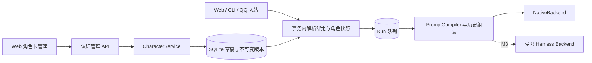
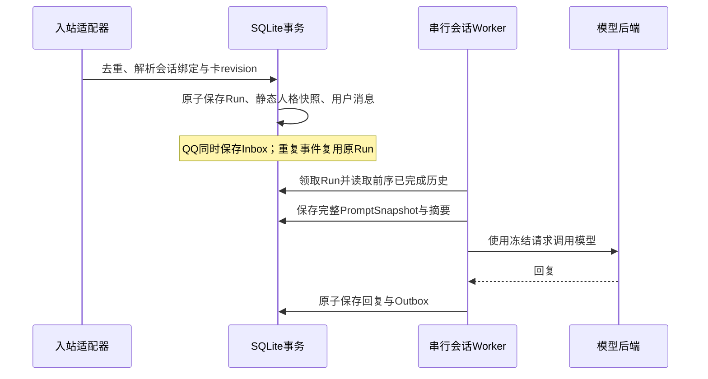

# DSH 角色卡设计：基于 AIRI 思路的独立实现

日期：2026-10-24。版本：设计稿 0.1。**本次交付是设计、交换格式 Schema 和示例，尚未实现角色卡服务、管理页面或数据库迁移，也未改变当前运行实例。**

## 1. 采用方案与边界

采用 AIRI 的三个思路：以 Character Card V3（CCv3）描述角色内容，以命名空间扩展表达模块偏好，将编辑、角色选择和运行投影分开。DSH 使用 Rust、SQLite 和现有 Vue 管理页面独立实现，不引入 AIRI、`@proj-airi/ccc`、Pinia 或其显示模型运行时，不复制上游代码、默认人格、提示词或美术资源。

AIRI 研究快照为 `300773ef28299f2bead06abf97d998f5bb4055db`。具体实现观察、固定源码链接与临时源码清理记录见 [研究记录](research/airi-character-card-review.md)。设计判断和 DSH 新增约束均属于本项目，不冒称是 AIRI 已有行为。

首期提供文本人格卡：创建、编辑、导入预览、校验、提示词预览、隔离测试、发布版本、设为新会话默认、归档和导出。图像、语音、形象、世界书检索及自主生成插件随后续阶段接入，导入一张卡不会自动启用这些能力。

## 2. 与现有 M1 的衔接

| 当前代码事实 | 本设计的改动落点 |
| --- | --- |
| `config.rs::AssistantConfig` 只有名称、系统提示、并发和超时 | 卡独立存储；模型地址、凭证、渠道、并发与超时继续属于宿主配置 |
| `worker.rs::enqueue` 接收 Web / CLI 消息 | 在入队事务中固定角色版本和静态人格快照 |
| `qq.rs::ingest` 直接事务写入 Inbox、Run 和消息 | 共用角色解析器，保留同一事务，不能只修改 Web 入队路径 |
| `worker.rs::process` 按会话读取历史，添加单个 system 消息 | 引入统一 PromptCompiler；完整请求快照在执行前生成 |
| `runs.config_json` 已冻结模型配置 | 增加角色快照，不在执行时查询“当前活动卡” |
| `state.rs::open` 尚无版本化迁移框架 | 先补迁移版本、事务和兼容检查，再新增表 / 列 |
| Vue `App.vue`、`types.ts` 使用全局助手名 | 对话显示绑定角色及 revision；角色编辑与模型配置表单分开 |

以下组件名、表结构、路由和行为均为拟实现设计；现有源码路径在 `crates/dshd/src/` 和 `web/admin/src/`。

## 3. 服务与依赖

- `CharacterService`：卡 CRUD、校验、发布、默认引用、导入转换与归档。
- `CharacterResolver`：在调用方提供的 SQLite 事务内读取已应用配置、解析会话归属、固定 revision 和模块映射；默认引用与模型配置来自同一事务视图，不得内部另开事务或调用网络。
- `PromptCompiler`：纯逻辑，输入明确、排序确定、带版本号；不读取任意文件、不调用模型、不修改卡。
- `CharacterRepository`：先放在 `dshd` 内实现，稳定后再拆 crate；通过 Cordis 服务注入供管理 API、入站与 worker 使用。服务撤销后停止新角色任务准入，已持久化快照的任务按原取消 / 清理规则处理。

一张卡是数据，不是一个常驻 Agent。卡库和历史会话不各自创建 Node、模型进程或 worker。

## 4. 交换格式与本地身份

使用 CCv3 envelope：`spec=chara_card_v3`、`spec_version=3.0`；DSH 扩展位于 `data.extensions.dsh`，其中 `schema_version=1`。归一化结果必须满足 [DSH 文本卡 Schema](schemas/dsh-character-card-v1.schema.json)，示例为 [Campanus 助手卡](examples/campanus.character-card.json)。这是受限 CCv3 配置，不是完整 CCv3 或 AIRI 的无损备份格式。

| 字段 | DSH 首期语义 |
| --- | --- |
| `name`、可选 `nickname` | 身份展示；模型使用 `name`，昵称作为补充，不替换数据库 ID |
| `description`、`personality`、`scenario` | 身份背景、稳定性格、对话场景，进入静态人格段 |
| `system_prompt` | 管理员审阅的人格指令，不能替代宿主操作约束或授予工具权限 |
| `mes_example` | 作为带“虚构风格示例”标记的文本放入人格段，不写入真实消息历史，不产生 tool 消息 |
| `first_mes`、`alternate_greetings`、`group_only_greetings` | 开场白模板；首期仅 Web 新会话展示，不自动给 QQ 发消息，也不冒充已经生成的回复 |
| `post_history_instructions` | 保存并在编辑器标注“首期不执行”；预览显示未参与编译，不能悄悄追加高优先级消息 |
| `creator`、`creator_notes`、`tags`、`character_version` | 管理与分享元数据，不进入模型提示；内容版本标签不等于数据库 revision |
| `extensions.dsh.modules` | Chat / Vision / Speech 的非秘密偏好，由服务端解析；不包含 endpoint、凭证或本机路径 |

本地 `card_id` 为服务端生成的 UUID，不放进可分享卡作为可信身份。导入总是创建新卡草稿；覆盖已有卡必须从该卡显式创建草稿，并携带并发控制信息。来源、源格式、输入摘要、转换器版本与丢弃字段清单保存在本地审计元数据，不作为模型指令。

人格、用户事实、情绪 / 会话状态分别保存：卡回答“助手是谁、如何表达”；记忆回答“与当前用户发生过什么”；动态状态回答“本次对话处于什么状态”。模型不得通过普通聊天改写已发布卡。

## 5. AIRI 导入与导出契约

首期输入为 UTF-8 CCv3 3.0 JSON，或 AIRI 分享 ZIP：根目录 `manifest.json` 声明 `format=airi-character-card`、`version=1`，卡路径严格为 `card.json`。只提取文本与可解释的偏好，不安装资源。PNG 内嵌卡、CHARX、V1/V2 及其他版本不在本期承诺内，明确返回 `unsupported_card_format`。

| AIRI / CCv3 输入 | 转换处理 |
| --- | --- |
| 上表身份、人格、场景、系统提示和开场白字段 | 映射同名字段，缺少可选内容补空值并显示转换结果 |
| `mes_example`、`post_history_instructions` | 按 DSH 自身语义处理；不能因 AIRI 分享包没有带出示例就声称已经恢复 |
| `extensions.airi.modules.consciousness` | 转为 `dsh.modules.chat` 的 provider / model 提示，不直接切换模型配置 |
| `extensions.airi.modules.vision / speech` | 转为待绑定偏好；语音 voice_id 仅作为提示，不视为本机已存在的音色 |
| `assets`、`character_book`、来源日期与多语言备注等本期未支持字段 | 不写入归一化卡；在导入报告逐项列出，不能静默宣称无损 |
| AIRI 唤醒词、agents、artistry、显示模型、workflowId、本机资源 ID 与未知扩展 | 不执行、不导入运行状态；报告丢弃字段路径，不回显潜在秘密值 |
| 端点、token、API key、工具 / 插件授权、脚本或自动动作配置 | 不采纳；已知秘密字段返回字段级错误，不写日志或导入草稿 |

导入流程为 **上传 → 有界解析 → 转换差异 / 警告预览 → 用户确认转换内容 → 创建草稿**。导入、保存和发布都不会设为默认角色。确认只针对卡内容转换，不授权运行脚本、下载外部资源或修改权限。

服务端校验分两层：先对外部envelope有界解析和字段分类，再把白名单结果按DSH Schema严格校验。JSON须为合法UTF-8，拒绝重复对象键、非标准数值及超深嵌套，避免不同解析器对同一文件解释不同。不得直接把外来JSON反序列化成宿主RuntimeConfig。未知字段不透传到 `extensions.dsh`，归一化对象拒绝额外字段。

AIRI模块值须先验证类型再做完整性分类：缺失 / 空白字符串视为空，非字符串值返回字段错误；provider/model均为空转为inherit，均非空转为prefer；仅一项有值时在导入预览保留待补全问题，用户须补齐或显式选择inherit / disabled后才能生成合法草稿，不能静默丢失。提示值去除首尾空白，voice_id没有完整provider/model时同样列为待处理提示，不跨provider拼接音色。

树莓派初始限制：JSON 256 KiB；ZIP 压缩体 8 MiB、目录条目最多64、声明解压总量32 MiB、单个被读取的 JSON 256 KiB、压缩比最多100、JSON 深度32。限制同时检查目录声明和实际读取字节；不解压到文件系统，不递归打开嵌套模型包。发现路径穿越、绝对路径、盘符、反斜线歧义、重复 / 规范化冲突条目、符号链接、加密包或已读取JSON的CRC校验失败即拒绝；未知资源只列名和大小，不加载、不抓取URL，也不声称已经校验其内容或CRC。大型 AIRI 形象包会被明确拒绝，用户可改用文本 JSON。

临时上传置于 owner-only 目录，操作归属当前管理员，15分钟过期并清理；转换确认绑定输入摘要和转换器版本，不能换文件后沿用旧确认。审计只记摘要、格式、字段路径和结果，不记原始卡正文。卡文本本身也可能含敏感信息，禁止把 secret store 内容写入导出；未知文本中的秘密无法靠字段过滤保证发现，导出预览必须呈现实际内容。

导出首期只生成归一化 CCv3 JSON 和 `extensions.dsh`，不输出 AIRI ZIP，不携带数据库 ID、会话、用户记忆、草稿历史、endpoint、credential_ref 或本机模块绑定。它是人格分享文件，数据库备份另走既有备份流程。

## 6. 模块继承与激活解析

不沿用 AIRI 空字符串代表继承的方式，使用明确模式：Chat 为 `inherit / prefer`，Vision 与 Speech 为 `disabled / inherit / prefer`。`prefer` 必须给出 provider_hint 和 model_hint；Speech 可额外指定 voice_hint。提示是对能力的偏好，不是可执行配置引用。

- `inherit`：绑定当前宿主已应用的对应模块配置，不修改全局默认。
- `prefer`：管理员在本机完成映射后才可使用；provider、model、voice 必须来自同一配置归属，不能换 provider 后借用另一 provider 的旧 model / voice。
- `disabled`：不为这张卡调用对应模块；卡不能反向打开宿主禁用的能力。

本机映射单独保存 `card_id + revision + module + local_profile_ref`，不进入分享文件。M1 只有一套全局文本模型：首期 Chat 默认 inherit；prefer 只能明确映射到现有模型，否则阻止绑定并返回 `module_unmapped`。不创建第二套模型账户或凭证。

首期只有 Vision / Speech 的 disabled 可参与运行绑定；导入其他值可保存草稿，但绑定前须改为 disabled 或等待 M4。UI 标注未实现，不能以“继承”暗示已有视觉 / 语音服务。继承结果在每个 Run 入队时与当时模型配置一同冻结，修改全局模型只影响随后入队的 Run，不重写队列快照。

校验分别返回“文档格式有效”和“当前实例可绑定”；首期发布、设为默认、创建正式或测试会话均要求后者通过。之后本机模型配置发生变化时，下一次入队重新校验映射，失效就明确拒绝新Run，不回退到未经选择的模型，也不修改旧Run快照。

## 7. 草稿、版本与会话归属

卡草稿可编辑，发布版本不可变。保存草稿、发布版本、设置新会话默认是三个独立动作；保存活动卡草稿不触发运行更新。恢复历史内容创建新 revision，不修改原 revision 或历史任务。

全局默认值是精确的 `(card_id, revision)` 引用，不是浮动 latest。发布 revision 2 不会将默认 revision 1 或已有会话自动升级。新会话在创建 / 首次入站的事务内固定引用；后续入队只读取该会话绑定。

首期切换人格创建新会话。Web / CLI 可以选择已发布版本；QQ 新会话使用实例默认，现有 QQ 会话需要管理员显式“以新角色重新开始”，创建后继会话并原子切换该平台会话映射，旧消息和旧 Run 归属不变。QQ 普通消息不能直接改变默认卡或访问管理接口。后继会话仍沿用当前 QQ 主体隔离，不能因换卡混入其他用户历史。

归档阻止新绑定，已绑定会话继续使用其不可变版本；首期不提供硬删除。紧急停用时先关闭新准入并显式处理 queued / running 任务，不把归档等同于撤销已发出的平台消息。

## 8. 两次冻结与提示词语义

**入队冻结静态人格，执行前冻结完整上下文。** 如果入队就冻结全部历史，同一会话排队的第二条消息会漏掉第一条尚未生成的回答。

静态快照包含 card_id、revision、规范化卡摘要、compiler_version、编译后人格文本及已解析的模块配置版本、非秘密配置和摘要。本机凭证只固定credential_ref，不保存密钥明文；不能只存profile ID后在执行时重新解析浮动配置。动态宏只允许 `{{char}}` 和 `{{user}}`，后者来自当前会话已校验的称呼；取值在入队时冻结，不执行JS、模板表达式、文件引用或shell。未知宏按字面保留并警告，不做递归替换。

DSH NativeBackend v1 使用单个 system 消息，确定顺序为：宿主操作约束 → 角色指令与身份 / 性格 / 场景 → 标注的风格示例；其后是合法角色的真实历史和当前用户消息。creator_notes、开场白、post_history_instructions、未知扩展和资源字段不进入 system 消息。不要靠分隔标签声称能完全阻止提示词注入；工具调用仍由宿主授权和参数校验控制。

输入历史沿用前序已完成 Run 的边界，不能包含未来排队用户消息。执行前生成的 PromptSnapshot 存储编译器版本、完整消息 JSON 和摘要，与 Run 同等访问和保留策略，不经普通状态 API 回传，也不写日志。快照持久化失败则不发送模型请求。

总静态人格最多32000 UTF-8字节；Schema 的 maxLength 仅为字符限制，不能替代此上限。示例超过预算时只按完整示例块裁剪并给预览警告，核心身份 / 指令超限则拒绝。历史延续当前最多24条 / 64000字节上限；完整请求另设96000字节上限，保留当前输入并按完整旧轮次裁剪。字节预算不冒充模型 token 上限；实施时按可用模型上下文元数据 / tokenizer 补充校验，未知限制或 provider 拒绝返回明确错误，不静默重写核心人格。

测试预览不调用模型；“测试对话”是管理员显式发起的独立会话、使用草稿摘要快照，不绑定 QQ，不写用户长期记忆。测试时冻结 draft_etag，继续编辑不改变该测试会话。

M3 接入 Harness 时复用同一静态人格投影与来源摘要；会话键包含角色 revision、模型绑定摘要和隔离域，换人格创建新 Harness 会话。Native 与 Harness 的消息角色适配分别验证，不能把卡指令写进上游默认 home 或覆盖 Harness 的工具 guard。

## 9. 存储、并发与 API

以下为逻辑表设计，实施时使用 SQLite 外键、事务与迁移版本落地：

| 存储 | 关键内容 / 不变量 |
| --- | --- |
| `character_cards` | UUID、created_by、archived_at；同名可以存在，ID 不复用 |
| `character_card_revisions` | `(card_id, revision)` 主键、canonical_json、SHA-256、schema_profile、created_at、来源元数据；发布后不可改 |
| `character_card_drafts` | draft_id、owner、base_revision、draft_etag、card_json；用 If-Match 防覆盖 |
| `character_module_bindings` | 卡revision与本机profile映射、binding_etag；不保存秘密明文 |
| `conversation_character_bindings` | conversation_id 唯一、card_id、revision；会话归属仍由既有 owner / source_key 决定 |
| `runs` 新增可空列 | character_snapshot_json、character_digest、compiler_version；NULL 为旧M1行为 |
| `run_prompt_snapshots` | run_id 唯一、messages_json、digest、创建时间；联网前写入 |
| `settings['character.default.v1']` | 精确卡引用及ETag，保持旧 RuntimeConfig JSON 结构不变 |

摘要算法固定为 SHA-256；对归一化 JSON 用确定性序列化：对象键按 Unicode 标量顺序排序、UTF-8、无额外空白、数组顺序与字符串内容保持、整数十进制。本配置不使用浮点数；UUID、revision等本地字段不混入可分享卡内容摘要。编译器摘要还纳入 compiler_version 和实际宏取值，避免同卡不同投影误判相同。

所有新路由位于 `/api/admin/v1`，复用当前管理认证、资源授权、CSRF、精确 Origin、大小限制与审计。普通 QQ 主体不能调用。首期沿用实例管理员权限，未来增加 workspace scope 时必须逐资源校验，不把 Cordis 服务注入当成用户授权。

当前router全局请求体上限为128KiB；新增导入路由需单独设置上述JSON / ZIP限额，并在流式读取中执行硬限制，其他管理接口保留现有限额，不能为导入放宽全局上限。

| 拟实现接口 | 语义 |
| --- | --- |
| `GET /character-cards`、`POST /character-cards` | 分页列表；创建空卡和草稿 |
| `POST /character-cards/import/inspect` | 上传解析，返回 owner-bound import_id、摘要、字段差异和警告 |
| `POST /character-cards/import/{import_id}/confirm` | 确认转换结果，创建新卡草稿；不发布或绑定 |
| `POST /character-cards/{id}/drafts`、`PUT /character-cards/{id}/drafts/{draft_id}` | 从指定 revision 建草稿；更新要求 If-Match |
| `POST .../drafts/{draft_id}/validate`、`.../preview` | 返回字段错误、模块映射、参与 / 不参与提示词的段落和字节预算 |
| `POST .../drafts/{draft_id}/test-conversations` | 显式创建隔离测试会话；复用既有入队 / 取消机制 |
| `POST .../drafts/{draft_id}/publish` | If-Match + Idempotency-Key，验证通过后原子创建下一个 revision；重试不重复发布 |
| `GET /character-cards/{id}/revisions`、`.../revisions/{revision}/export` | 历史、指定版本导出；首期仅JSON |
| `PUT /character-cards/default` | If-Match固定已发布引用，只影响之后新会话 |
| `POST /character-cards/{id}/archive` | If-Match归档，不删除历史 |

创建会话接口可指定已发布卡引用；读取会话和Run返回实际角色名称、revision、摘要及是否legacy。发布版本和默认绑定分别审计；409不覆盖草稿，422返回稳定字段路径，413表示体积超限，415表示格式不支持。Idempotency-Key 绑定操作者、路由和请求摘要，相同键不同内容返回409。

## 10. Web 管理体验

新增“角色卡”入口，卡库展示草稿、已发布、当前默认、归档状态。编辑分为身份、人格与表达、对话示例 / 开场白、模块偏好、预览与版本。首期不展示假可用的Live2D / 语音配置入口。

页面分别提供“保存草稿”“发布版本”“设为新会话默认”；状态文字说明每一步实际影响。导入页先展示支持字段、暂不执行字段、丢弃项和待映射模块；禁止默认勾选修改全局模型或执行额外动作。预览同时显示最终人格文本和不参与运行的字段，便于发现“写了但没有生效”。

测试对话与正式对话明确标识。正式对话标题显示本会话绑定版本，修改默认卡后不跟着变名；需要换角色时提供新会话入口。轮询只更新状态，不重载未保存表单；页面关闭时提示未保存，跨标签更新用ETag冲突处理，不实现上游的浏览器leader驱动运行机制。

## 11. 迁移、回滚与资源

1. 先引入带版本号的事务迁移和部署能力清单，使用SQLite一致性备份接口保存升级前快照。
2. 新表与列增量创建；不重写已有 config_revisions、messages、Inbox / Outbox 或 queued Run 的 config_json。
3. 旧会话和旧Run保持legacy；只有管理员选择启用角色卡时，才从当时已应用的 assistant.name / system_prompt 精确生成“原有助手”草稿并发布为默认。首次采用卡编译器属于显式行为变更，不宣称与旧裸提示词字节相同。
4. 角色默认引用置于独立 settings；旧 AssistantConfig 保留作为legacy路径，角色模式下UI明确其不再控制新卡会话，不能同时维护两个互相覆盖的人格来源。
5. 已运行的17b7ee0对 RuntimeConfig 使用 deny_unknown_fields；因此不得直接向旧配置JSON塞入角色字段并承诺旧版本能读。即使采用独立表，旧worker也会忽略新Run的角色语义，不能直接切回旧二进制处理新队列。
6. 部署 / 回滚脚本需检查数据库功能标记与目标release能力清单。存在角色绑定或角色Run时拒绝回退到不支持角色快照的版本；可回到支持该快照版本的release。确需降级时先停准入、处理队列、经管理员明确选择legacy行为，并按独立数据恢复流程执行；旧二进制手工启动不属于受支持的回滚路径。

卡解析与编译共用主进程，初始缓存最多32张 / 2 MiB，只缓存按内容摘要 + compiler_version索引的规范化卡 / 未展开模板，不缓存逐Run投影。未来缓存已展开结果时，键还必须纳入宏取值、模块绑定摘要和隔离域，不能跨用户复用称呼或模块配置。import解析并发1，不新增后台LLM人格评估请求。生产Run并发仍为1到2，语音 / 视觉worker只在其阶段通过实机资源验证后启用。最终平台为Pi5 / 8GB / Raspberry Pi OS Lite 64位；当前Ubuntu验证例外不变。

## 12. 实施顺序与验收条件

| 顺序 | 交付 | 必须验证 |
| --- | --- | --- |
| C1 契约与存储 | Rust类型、Schema语义、迁移、草稿与不可变revision | 未知字段、字节限制、重复发布、ETag冲突、归档和历史恢复 |
| C2 编译与任务 | 共用解析器、两次冻结、Web / CLI / QQ接入 | QQ事务去重；排队后改卡不变；第二条包含第一条已完成回答；旧Run行为保留 |
| C3 管理与交换 | 卡库、编辑、预览、测试、JSON / AIRI ZIP导入、JSON导出 | 未认证 / CSRF / 越权拒绝；有损转换可见；ZIP安全边界；密钥不导出；移动端与脏表单 |
| C4 实机验收 | 先提交推送，再按完整SHA部署 | Ubuntu授权环境先测真实QQ角色回复；后续Lite回归；当前默认与会话绑定版本一致，重启不漂移 |

跨阶段用例还包括：同名卡不串会话、改变默认不修改旧会话、换provider不混用model / voice、未知宏不执行、恶意角色文本不能授予工具权限、保存草稿不影响正在运行任务、完整请求快照写失败时不调用模型、导入资源不触发外联、回滚拒绝不兼容release。

本次只验证设计文件与示例一致性、链接、Schema及清理结果；上述运行验收属于后续实现，不能记为本轮通过。
