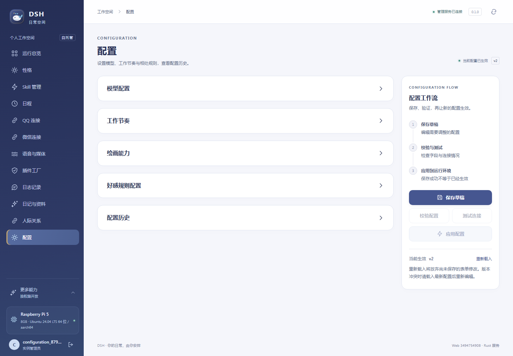

# 配置页与入口整理验收

## 当前页面契约

2026-10-26 用户确认的整理已在本轮实现：

- “性格与模型”改称“性格”，只保留实例性格编辑与其独立版本保存。
- “配置历史”改称“配置”；五个默认收起的抽屉依次为模型配置、工作节奏、绘画能力、好感规则配置、配置历史。
- 前三项沿用运行配置的保存草稿、校验、连接测试、应用流程。好感规则在本抽屉独立填写依据、确认并保存，保留版本冲突和停机预演。历史仍可刷新和恢复，旧 `#history` 链接映射到 `#config`。
- 人际关系移除好感规则区域；QQ 连接移除底部能力接口探测、高级测试管理和不确定投递诊断面板，保留账号配置、连接测试与运行状态。
- 日程仅保留日历、工作目标与授权。阅读保留为普通活动类型，资料选择、提供和撤销收纳到阅读活动编辑器内的“阅读资料”，不清除既有资料，也不取消阅读授权边界。

没有后端 API、数据库 schema 或运行配置默认值变更。正式配置、性格、记忆和用户数据不因本次页面整理被改写。

## 本地检查

Windows 仓库 `D:\CodeProject\DSH`；仅纳入本次相关文件，保留开始前已有的 AGENTS、README、architecture、diary-system、life-systems-validation 及日记结构证据修改。

- `npm.cmd run build`：退出 0，Vue / TypeScript 与 Vite 静态生产构建通过。
- `npm.cmd test`：退出 0，24 个文件、161 项通过，包含阅读入口和好感配置的新回归测试。
- `npx.cmd playwright test tests/e2e/configuration-layout.spec.ts --list`：退出 0，综合用例解析通过；解析不代表浏览器执行通过。
- `git diff --check`：退出 0。
- SDD 查询当前授权上下文后，仓库 `commit-context` 未匹配到可访问的 SDD 项目，且没有 SDD 管理的提交钩子；未安装或绕过提交检查，沿用普通提交格式。

## 远端发布与验收

发布 SHA：`34947549085ce73b3ff49889f17c942d7a344629`，2026-10-26 **20:14:45（Asia/Shanghai）** 部署到 `campanus@192.168.189.191`。源码、前端 release.json、健康接口均核对为此完整 SHA。目标再次确认是树莓派 5、8GB、Ubuntu 24.04.4 LTS / aarch64；Cargo / Rust 1.88.0。远端当前 SSH shell 没有 Node，静态前端在 Windows 构建，生产不运行前端开发服务器。

本地 `deploy/package-web.ps1 -Commit <上述 SHA>` 使用锁定依赖重新构建，退出 0；前端归档 SHA256 为 `13bd5f8de5af716d6c83a2968348c717f279e17b8a253d98442ac341f0fc6e79`。先推送并验证 origin/main 包含目标 SHA，再复制归档并执行：

```sh
DSH_BUILD_JOBS=1 DSH_CARGO_MIRROR=rsproxy bash /home/campanus/.cache/dsh/deploy.sh 34947549085ce73b3ff49889f17c942d7a344629 /home/campanus/.cache/dsh/admin-34947549085ce73b3ff49889f17c942d7a344629.tar.gz 13bd5f8de5af716d6c83a2968348c717f279e17b8a253d98442ac341f0fc6e79
```

部署命令退出 0：`cargo test --workspace --locked -j 1` 共 **391 项通过、0 失败**；`cargo build --release --locked -p dshd -j 1` 通过，发布编译耗时 9 分 18 秒。源码目录工作区干净。`systemctl --user` 显示服务 active/running、NRestarts=0；`/health/live` 为 ok，`/health/ready` 为 ready。部署启动轮询曾在新进程监听前收到一次连接拒绝，随后同一轮核对完整 SHA 成功；原始部署日志保留，没有将首次连接拒绝单独记作通过。

## 浏览器、权限与配置生效

在远端用本次 Linux 制品和静态资源启动 `tools/skills-browser-fixture.py --port 18422`；使用独立临时数据库、合成账户与 loopback 模拟模型，通过 SSH 隧道运行本地 Chromium。另一验证占用的 18421 未被终止或覆盖。配置用例明确拒绝生产端口；测试源码最终提交为 `d8627e3aff53a0c678f120d0c435f16cde0449ee`，后续只改截图等待，不改变运行程序。

```powershell
# DSH_E2E_BASE_URL=http://127.0.0.1:18422；账户、配对文件和 fixture 信息仅引用忽略目录中的隔离测试文件。
npx.cmd --prefix web/admin playwright test --config web/admin/playwright.config.ts web/admin/tests/e2e/configuration-layout.spec.ts
npx.cmd --prefix web/admin playwright test --config web/admin/playwright.config.ts web/admin/tests/e2e/life-systems.spec.ts
```

两项独立综合用例均退出 0。验证新导航与旧 history 链接、五抽屉顺序/默认折叠/键盘操作、原页面不再挂载旧区域、好感规则首次展开才加载且收起不丢表单、跨 QQ 页面保留待保存字段、替换密钥不回显/不进入配置和历史/不进浏览器持久存储、草稿→校验→模拟连接测试→实际应用、缺 CSRF 拒绝 403、过期配置应用拒绝 409、好感规则携版本和明确确认保存。日程用例实际从阅读活动内提供文字资料，保留未授权不能保存、预演、批准系列、月/议程及移动布局验证。

桌面 1440px、手机 390px 与 320px 无水平溢出，浏览器无脚本错误。初次截图中一张手机图仍带“读取历史”状态，原图保留在 `.local/configuration-layout/screenshots/`；增加等待后重跑配置用例通过，最终截图使用 `.local/configuration-layout/screenshots-final/`。这不是运行功能失败。

正式浏览器使用原 Edge 管理会话只读复核：侧栏显示“性格”“配置”；性格页只保留刘嘉卉 v2；配置页按要求显示五个收起抽屉；QQ 页只有业务连接配置与实际状态，WebSocket 已连接；日程只保留日历、工作目标与授权，阅读仍在普通活动类型中。正式运行配置仍为 v6，没有执行保存、模型调用或渠道发送。

正式服务的 config、config/revisions、secrets、relationships/affinity-policy、schedule/resources 五个匿名访问均为 401。正式配置、性格、稳定身份、好感策略、来源策略及授权等摘要前后相同；日记/人物/记忆/会话计数均无变化。完整去敏结构结果见 [JSON 证据](validation/configuration-layout.json)。



[320px 展开布局截图（隔离合成账户）](validation/configuration-layout-mobile.png)

## 数据、日志与回滚

切换前版本为 `df2539f56cfcbca7b17d29d343b3f104148c3d2a`，已保留；部署前自动备份位于 `shared/backups/pre-34947549085ce73b3ff49889f17c942d7a344629-20261026T121443896733540.sqlite`，只读 quick_check 为 ok。本轮没有数据迁移，没有执行回滚。部署失败时仍按 compatibility gate 判断旧 reader 是否可恢复，不盲降 reader2 数据。

远端日志：`shared/logs/test-34947549085ce73b3ff49889f17c942d7a344629.log`、`shared/logs/build-34947549085ce73b3ff49889f17c942d7a344629.log`；本地部署及摘要记录在 `.local/configuration-layout/`。浏览器 fixture 日志位于 `shared/validation/configuration-3494754/fixture/daemon.log`。验收后仅停止本轮 fixture PID 915384 及其子进程，关闭本轮 18422 隧道，保留证据与临时数据供诊断。

没有新增真实模型、QQ/微信发送或客户端播放验收，也没有重新执行自主阅读模型任务；本轮范围是已实现能力的页面整理，模拟模型连接测试不等于真实外部模型或平台联调。后续报告/截图测试提交只涉及文档和测试，正式运行 SHA 保持上述发布 SHA，无额外重启。
