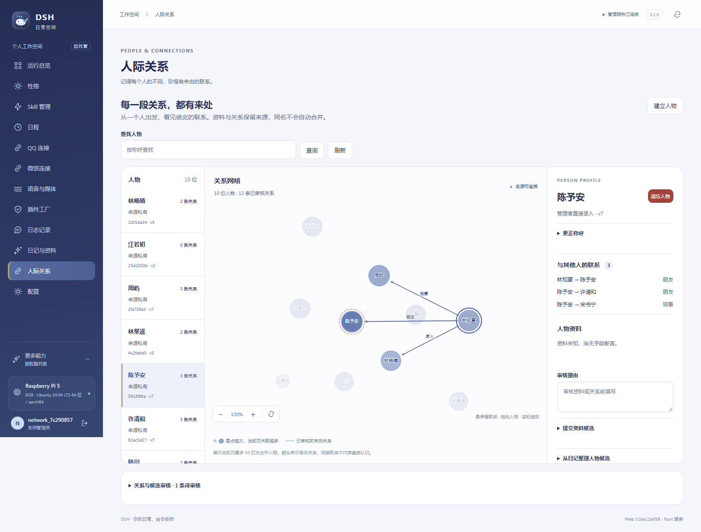

# 人际关系网络交互动效验收

2026-10-26 用户要求参考 [Connected Papers 指定论文图](https://www.connectedpapers.com/main/0b4c513b66754d5e7c700508629e2d28b1061609/Science-mapping-software-tools:-Review,-analysis,-and-cooperative-study-among-tools/graph)，按 DSH 现有 UI 风格调整关系网。

## 实现范围

通过真实浏览器查看参考页的圆点、连线、选中、平移及缩放交互，使用本项目代码独立实现，未引入其源码、资源或第三方动画依赖。沿用 DSH 靛蓝、灰蓝、柔和金色和三栏布局，加入短暂展开与收敛、节点拖动和关联节点轻随、实时有向连线、悬停/键盘聚焦强调、固定人物选择、平滑缩放。拖动位置只存在页面内，不写入人物或关系 API。

动效与渲染只使用当前页有效人物和已审核关系；无新增人物、同名合并或推断边。动画空闲后停止，页面隐藏/离页回收，减弱动态模式保留可用的静态图与人工操作。

## 本地检查与保留诊断

- Vue/TypeScript、Vite 生产构建通过，25 文件 167 项 Vitest 通过，Prettier 与差异静态检查通过。
- Windows 隔离旧后台制品 + 本轮前端的综合浏览器预检通过，10 位合成人物、12 条已审核关系、1 条待审关系；仅证明本地界面，不作为远端发布验收。
- 首轮浏览器测试在缩放过渡进行时测量了旧坐标矩阵，出现约 4.4 个图内坐标单位的拖动偏差（阈值 <3），不计通过。修正为实际缩放和物理布局共用请求帧，拖动冻结当前显示比例，坐标使用实际 viewport 逆变换；测试等待缩放停稳后保持原 <3 图内坐标单位的要求。失败摘要保留 `.local/relationship-motion/initial-browser-failure.json`，首轮截图及上下文保留在对应本地验收目录。修复后预检通过。
- 另修正高刷新率场景的重复帧数上限，统一按物理模块的时间预算收敛，不按帧数提前截断拖动后的运动。

## 远端发布

应用提交：`31ba12a056c7a1c6993c729a0e9042d34abb5dff`；已推送并验证远端 origin/main 包含此 SHA。部署成功时间：**2026-10-26 21:22:42（Asia/Shanghai）**。上一可用 SHA 为 `34947549085ce73b3ff49889f17c942d7a344629`。本地共享目录存在并行后端工作，打包改用固定提交的独立 Git worktree，没有暂存、覆盖或部署其未提交文件。

目标再次核验为树莓派 5 Model B Rev 1.1、8GB（8,318,562,304 字节）、Ubuntu 24.04.4 LTS / aarch64，预检可用内存 7,702,020,096 字节，Rust/Cargo 1.88.0。前端在本机通过锁定依赖构建，以静态资源随同一发布版本交给 Rust 服务。

```powershell
./deploy/package-web.ps1 -Commit 31ba12a056c7a1c6993c729a0e9042d34abb5dff
# Git 私有 artifacts 目录中的归档复制到远端私有缓存。
```

```sh
DSH_BUILD_JOBS=1 DSH_CARGO_MIRROR=rsproxy bash /home/campanus/.cache/dsh/deploy-relationship-motion.sh 31ba12a056c7a1c6993c729a0e9042d34abb5dff /home/campanus/.cache/dsh/admin-31ba12a056c7a1c6993c729a0e9042d34abb5dff.tar.gz 86ac20963fe752d728506ba671913bb3078c6018592cb7311f9c7214c1484dca
```

命令退出 0。Linux `cargo test --workspace --locked -j 1` 共 **391 项通过、0 失败**，其中 dshd 387 项耗时 208.78 秒；release 构建 9 分 15 秒，单并发。归档摘要与上面命令一致；源码工作区干净，HEAD、静态 release.json 与运行健康接口均为完整应用 SHA。服务 active/running、NRestarts=0，live=ok、ready=ready。切换后的首次探测在监听建立前短暂连接拒绝，原始日志保留；同轮重试后核对 SHA 成功，没有将失败探测计作通过。

## 固定版本浏览器与权限验收

使用本次 Linux 二进制和静态目录，`tools/skills-browser-fixture.py --port 18422` 启动全新临时数据库，经本机 SSH 隧道使用 Chromium 访问；没有读取正式数据或调用真实外部模型。测试源码已推送至 `8cd92ca64f8baafdb2dea87bd1cf1df4ca3f91fd`，只补强取消/减弱动态的测试，不改变部署应用 SHA。

```powershell
# DSH_E2E_BASE_URL=http://127.0.0.1:18422
# DSH_E2E_EXPECT_SHA=31ba12a056c7a1c6993c729a0e9042d34abb5dff
# DSH_E2E_DATA_DIR 与 DSH_E2E_EVIDENCE_DIR 指向本轮忽略目录；配对文件/随机测试凭证不进入 Git 或报告。
npx.cmd --prefix web/admin playwright test --config web/admin/playwright.config.ts web/admin/tests/e2e/relationship-network.spec.ts
```

综合用例 **1 项通过，17.9 秒，退出 0**。10 位合成人物、12 条已审核关系和 1 条待审关系，仅前 12 条渲染并参与布局。验证加载后收敛且 RAF 不再增长、悬停/焦点不请求详情、点击/Enter/Space 与两侧联动、120% 缩放后拖动误差 <3 图内坐标单位、连线端点裁切和节点同步、相邻节点轻随、拖后不误选、实际节点捕获的同 ID pointercancel 后释放、背景平移/滚轮/重置、390px/320px 无溢出、拖动中离页回收全部 RAF。减弱动态下既验证静态不漂移，也实际手动拖动，确认节点/连线同步、动画状态不曾开启且 RAF 计数完全不变。浏览器无脚本错误。

正式人物、关系、好感策略和日记查询匿名访问均为 401，隔离账户无 CSRF 的写入为 403。正式 Edge 页面刷新后页脚已显示 `31ba12a056`。现有正式人物记录仍为 0，因此图交互在隔离合成账户实测，没有为演示向正式实例添加人物。正式配置、性格、稳定身份、来源/联系授权及好感策略指纹全部相同，日记、人物、关系、记忆、会话计数无变化。



[手机布局验收截图，隔离合成账户](validation/relationship-motion-mobile.png)

结构化身份、摘要、检查和图片哈希见 [JSON 证据](validation/relationship-motion.json)。

## 日志、数据与回退

部署前备份：`shared/backups/pre-31ba12a056c7a1c6993c729a0e9042d34abb5dff-20261026T132241095592811.sqlite`，只读 quick_check 为 ok；无数据迁移，本轮没有回滚。上一可用 reader2 制品保留，代码回退仍须通过 compatibility gate，不能将切换旧代码当作数据恢复。

远端日志为 `shared/logs/test-31ba12a056c7a1c6993c729a0e9042d34abb5dff.log`、`shared/logs/build-31ba12a056c7a1c6993c729a0e9042d34abb5dff.log` 和 `shared/validation/relationship-motion-31ba12a/fixture/daemon.log`。本地部署、首次失败、浏览器日志及前后指纹在 `D:\CodeProject\DSH\.local\relationship-motion\`；保留首次失败与通过截图。验收后仅停止本轮 fixture PID 947616 及其子进程并关闭本轮 18422 隧道；原管理入口和其他任务不受影响。

没有新增真实模型、QQ/微信发送或客户端播放验收，也没有声称支持万人关系图；当前页面仍按原权限显示最多 50 位人物。后续测试/报告提交不改变发布行为，正式运行 SHA 继续为上述应用 SHA，不为文档再重启。
