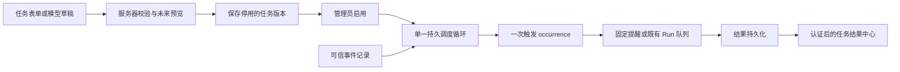

# 任务触发设计

日期：2026-10-25。版本：0.2，实现契约。用户审阅详细设计后已授权实现与部署；本轮已新增正式「任务触发」tab、持久调度器和默认「设置触发任务」Skill。本地已完成部分运行检查，正式部署与最终验收以 [运行验收记录](task-triggers-validation.md) 为准，不能用本文或 [T0 静态验证](task-triggers-design-validation.md) 代替。工作日、休息日采用中国法定节假日与调休安排，目前内置已核验的 2026 年版本；未覆盖年份阻断相应触发。

本文保留完整设计目标和验收矩阵。当前实现范围、固定限制与尚未验证项见运行验收记录；事件仅开放本人交互 Run 完成 / 失败和服务启动，结果仅投递到认证 Web 页面，外部 webhook、主动 QQ / 微信、完整 Cron / RRULE 仍为后续独立能力。

## 1. 目标与确定的产品选择

新增正式主导航「任务触发」，管理“何时或发生什么事件时，让助手做什么”。它管理未来规则；「任务与诊断」继续查询实际 Run、取消和故障。两者通过执行记录互相链接。

| 决策 | 采用方案 |
| --- | --- |
| 表达触发条件 | 一次性、固定间隔、日历、事件四种类型；普通用户使用表单，不输入 Cron |
| 工作日 / 休息日 | `cn-official` 已核验的中国年度安排，包含调休；与固定星期规则分开 |
| 模型设置任务 | 默认「设置触发任务」Skill 生成结构化草稿，页面审核、校验和预览后保存停用，管理员另行启用 |
| 调度与执行 | 一个协调循环、SQLite 持久化机会、现有 Run / 实际请求 lease；不为每条规则常驻进程 |
| 执行内容 | 固定提醒 `notify` 或助手执行 `assistant_run`；不提供任意脚本、shell、URL 请求、安装插件或文件修改动作 |
| 首个可交付结果去向 | 认证后的 Web 任务结果中心；任务离线执行，用户稍后登录查看，不等同于系统弹窗或手机推送 |
| 可靠性 | 本地触发键去重、受限补跑、有限重试；不承诺外部副作用恰好一次或硬实时 |
| 自动执行上下文 | 每次独立会话，默认无普通聊天历史、长期记忆、自动摘要与记忆候选 |

任务不创造新的权限。日历、事件源、模型、角色或 Skill 的停用和授权撤销均可阻断后续执行。未经实现和验收的渠道主动发送始终保持不可用。

## 2. 现有代码的落点

| 原有事实 | 本轮实现落点 |
| --- | --- |
| `worker.rs` 入队事务已冻结 RuntimeConfig、角色和 Skill | 抽出接受“服务器已批准任务快照”的专用事务入口，不能让模型直接拼内部数据库记录 |
| 当前 worker 最多两个实际 NativeLease，另有候选、视觉与诊断任务 | 自动任务共用该池，最多一个模型自动任务在途；不创建旁路并发池 |
| `main.rs` 通过 Cordis kernel 管理两个 worker 与渠道任务 | 新增一个可取消的 scheduler task，生命周期跟随 kernel |
| 启动已持有数据目录单实例锁；恢复会打断 running Run | 保留单实例约束与“不确认外部结果就不自动重跑”的语义；协调器租约不代替进程锁 |
| Skill 目前只有指令注入，没有通用工具调用循环 | 第一版用草稿桥接；不能把提示词写成“你已经有创建任务工具” |
| `skill-output.ts` 只识别制作 Skill 的 JSON | 新增明确的 `task_trigger_draft` 解析器与“审核任务草稿”，不猜测普通 JSON 的意图 |
| 当前 Skills 表无不可变历史正文 | 任务定义保存经审核的 Skill 全文、revision 和 digest，不能以后仅按旧 revision 查现表 |
| QQ 回复依赖原消息和截止时间；微信依赖会过期的 context token | 二者目前不能提供任意未来主动推送；不能把旧回复 token 存到任务里 |

本轮模块为 `trigger_rule`、`trigger_calendar`、`trigger_store`、`trigger_scheduler`、`trigger_execution`、`trigger_retention` 和 `trigger_api`，均在 `dshd` 内；事件持久化及匹配位于 store，模型执行复用现有 worker 和实际请求 lease。保持纯规则计算、存储、执行和渠道之间的依赖方向。第 8 节表格表达逻辑对象，当前结果 / 投递字段合并保存于 occurrence，而非要求每个对象单独建表。

## 3. 规则与时间的精确定义

### 3.1 一次性与秒间隔

| 用户表达 | 规则 | 明确语义 |
| --- | --- | --- |
| 11 月 1 日 09:00 提醒 | `once / at` | 必须解析出年份、完整时刻、IANA 时区和带偏移的绝对时间；过去时刻报错，不默认顺延 |
| 30 秒后提醒 | `once / after` | 第一版明确为“首次启用后 30 秒”；草稿等待十分钟不扣倒计时 |
| 每隔 30 秒提醒 | `interval` | 固定起点、固定频率；首次触发为首次启用后一个间隔 |
| 每分钟的第 30 秒 | 日历时间对齐能力的后续扩展 | 与“每隔 30 秒”不同；第一版不偷偷转换，表单说明当前支持范围 |

一次性相对规则在首次启用事务中持久化 `first_enabled_at + after_seconds`。间隔规则持久化 `first_due_at`，第 n 次为 `first_due_at + n × every_seconds`，n 从 0 开始。修改草稿、重启和暂停恢复不重置起点；规则本身重新安排时明确创建新的 schedule epoch，并在预览里说明新的倒计时起点。

轻量提醒间隔最小 1 秒，模型执行间隔最小 60 秒；上限为 31,536,000 秒。持续高频还受每日预算和全局限流约束。调度目标是秒级检查，到期、入队、开始、完成分别计时；不保证模型在指定那一秒完成，也不提供亚秒或硬实时调度。

### 3.2 日历规则

所有日期使用公历 `YYYY-MM-DD`，时刻使用 `HH:mm:ss`，星期为 ISO 1=周一至 7=周日。一次规则允许最多 24 个去重时刻。日期选择与 `day_class` 取交集，日期不符合筛选就跳过，不自动挪到前一或后一工作日。

| frequency | 选择器 | 边界行为 |
| --- | --- | --- |
| `daily` | 每个本地日期 | 可叠加工作日或休息日筛选 |
| `weekly` | `weekdays` | 固定星期；“周一到周五”不排除法定假日 |
| `monthly` | `month_days`，1–31 或 `last` | 每月 31 日遇短月跳过；`last` 才表示真正的月末；同一天重复命中只算一次 |
| `yearly` | `month_dates` 月日对 | 2 月 29 日仅闰年命中；不改为 2 月 28 日；2 月 30 日这种永不成立的组合校验失败 |
| `dates` | 最多 100 个具体日期 | 日期去重排序；每个日期可以有多个时刻；全部用尽后任务为 completed |

“明天”“下周一”等自然语言只在制作草稿时解析。服务器提供带时区的 `now`，模型不能用自身知识估计今天；服务器再次校验绝对结果。只有日期没有时刻、只有“早上”“下班后”而实例没有明确偏好时，先补问，不默认午夜。

`active_window.start_at` 为包含边界，`end_at` 为不包含边界，二者可为空。一次性最终 due 不在窗口内时启用返回 422；interval 保持原格点，跳到窗口内首个格点，不把窗口起点变成新锚点。候选机会还须未超每日预算且通过日历筛选。修改窗口不回放修改前的机会。

### 3.3 时区、夏令时与时钟

默认 `Asia/Shanghai`；每条任务保存明确 IANA 时区，禁止浏览器、服务器 Linux 时区或模型所在区域暗中覆盖。一次性绝对时间的偏移必须与所选时区在该日的实际偏移一致。未来日历计算记录 `tzdb_version`；时区规则会变动，依据见 [IANA 说明](https://www.iana.org/time-zones)。

本项目明确选择：日历重复规则遇不存在的本地时刻时跳过并记录 `dst_gap`；遇重复时刻时只选择较早 UTC 的一次，记录 `dst_fold=first`。一次性输入若本地时刻有歧义，必须明确偏移后才能保存。秒值仅 00–59，不接受闰秒输入。此为 DSH 产品语义，不宣称完整实现 RFC 5545 / RRULE。

持久到期和审计使用 UTC；进程睡眠与超时使用单调时钟，并至少每秒重新核对到期项。建议 `clock_jump_threshold_seconds=5`；超过阈值或系统时间未可信同步时，显示 `blocked_clock`，停止新自动执行。实施时读取 OS 同步状态；状态不可用不能假称已同步，允许管理员核对 UTC 后提供有截止时间的“已人工确认时钟”记录，不允许模型代填。不擅自修改主机时间或系统设置。恢复可信时间后预览差异、按漏触发策略推进；回拨不清除游标或触发唯一键，前跳不展开无限历史。该时钟信任适配器须在 T1 测试，不能将阈值当已测精度保证。

## 4. 中国工作日与休息日日历

在已核验覆盖区间内：工作日等于通常周一至周五，减去官方放假日期，再加上官方补班日期；休息日是该区间内工作日的补集。固定“周末”仅是周六、周日。中国通用安排不代表轮班、学校、自定义假期或个人请假；个人覆盖作为后续独立版本化日历，不暗中修改默认日历。

例如 2026-10-10 为周六补班，属于工作日；2026-10-01 为周四放假，属于休息日。两者已在 [北京市政府转载的国务院办公厅通知](https://www.beijing.gov.cn/zhengce/zhengcefagui/202511/t20251104_4258873.html) 核验。该通知只支持对应年度安排，不能推断未发布年份。

每个不可变日历版本保存：`calendar_id`、revision、覆盖起止日期、日历时区、工作 / 休息覆盖日期、发布机关、文号、发布日期、来源 URL、规范化内容哈希、管理员核验人与状态。来源 URL 是资料，不是任意下载命令；第一版由管理员导入受限 JSON 并审核，不运行任务时临时抓网页。首版使用 `cn-official` 的任务时区必须为日历时区 `Asia/Shanghai`，不自动在海外日期与中国日期间换算；其他时区的固定日期 / 星期任务仍可使用。

| 情况 | 行为 |
| --- | --- |
| 某年未导入 / 未核验 | 匹配结果为 unknown；依赖任务显示 `blocked_calendar`，不能回退为周一到周五 |
| 只覆盖当前年 | 可在已覆盖区间启用；预览标出 coverage end，越界前提醒、越界后阻断，不因无法算满 10 次而伪造未来日期 |
| 跨年缺数据但任务尚有今年机会 | 今年继续；到第一段未知区间停止推进该任务，其他无此依赖的任务不受影响 |
| 新版本导入 | 显示日期差异、受影响任务、未来时间变化；管理员应用后只重算未受理的未来机会 |
| 已受理 / 已入队的机会 | 固定旧日历版本和 UTC，保留原执行；需要取消时另行明确操作，不回写历史 |
| 时区数据库更新 | 与日历更新类似，保存计算版本并预览未来影响；发生过的 UTC 与触发键保持不变 |

日历 unknown 期间没有足够证据生成合法机会，因此不进入补跑集合；导入日历只恢复未来计算。事件任务在此期间记录 `blocked_calendar` 的抑制数量并推进自己的订阅 cursor，避免阻塞其他任务；导入后不会批量补发当时未知分类的旧事件，界面必须明示这一点。

## 5. 执行内容与版本冻结

`notify` 只保存固定提醒结果，不调用模型。可用模板仅为服务器列出的固定占位符，例如任务名、计划本地时间、脱敏事件摘要；无任意 JSONPath、文件、环境变量、SQL 或代码展开。替换后仍校验总大小并在前端转义。

`assistant_run` 执行明确的任务 prompt，可选择已启用 Skill、实例人格快照或已发布角色 revision。模板中引用的事件摘要通过独立 user-role 不可信资料提供，不插入系统指令；事件不能改变动作、owner 或目标。

| 内容 | 固定或重新检查的时点 |
| --- | --- |
| 任务规则、prompt、预算、结果去向 | 保存不可变任务 revision，启用后只有明确应用新 revision 才改变 |
| 角色与助手身份 | 启用时固定稳定 assistant identity；实例人格保存提示词 / 名称快照，角色卡保存已发布 revision 与投影摘要 |
| Skill | 启用时复制受审核全文、revision、kind 与 digest；编辑 Skill 不暗中更改任务指令，页面提示可审核更新 |
| Skill 停用 / 删除、角色不可用 | 每次派发复查，阻断新执行；不因为有旧正文就绕过撤销 |
| 模型地址 / 标识 / 凭据引用、宿主并发与超时 | 每次入队读取当时已应用 RuntimeConfig，并随 Run 冻结；实际限制取宿主与任务预算的较小值 |
| text / HTML 绘画 / 原生生图 | 属于明确批准的 `output_mode`；模型配置变化不自动升级收费路径或换执行方式，不满足时 blocked |
| 结果查看与投递权限 | 每次读取或投递重新校验 owner / 授权，任务中不保存 Cookie、CSRF 或临时回复 token |

输出方式还有服务器语义约束：text 允许无 Skill 或 instruction Skill；html_drawing / native_image 必须选择经批准的 drawing Skill，skill=null 时拒绝，不能把普通文本指令当绘画执行器。派发必须显式传递任务批准的执行方式，不能复用当前聊天“只读全局 image_generation 开关选路”的分支。当前模型不支持批准方式时 blocked_config，不静默换路。

管理员启用会形成有记录的持久执行授权，绑定 owner、动作、Web 目标、依赖与预算。正常退出登录或浏览器会话到期不取消该授权；账户停用、执行权限撤销、任务暂停 / 停止及明确撤销授权才阻断后续执行。派发复查的是这份授权，不要求保存或维持管理员 Cookie。授权版本只由启用 API 产生，模型草稿不能提供 grant_id 或替换批准人；新任务版本按预览要求重新确认相应授权范围。

每次助手执行创建独立、受 owner 管理的任务会话，普通对话列表默认过滤自动会话。可信 `context_policy=isolated` 禁止普通历史、长期记忆召回、自动摘要和记忆候选；不能借用角色测试 `is_test` 标志绕过隔离。执行历史通过任务专属 API 分页读取。后续若允许使用记忆，须另做明确范围与遗忘联动设计。

## 6. 事件触发

### 6.1 可信事件与目录

事件来源必须在服务器注册，先完成来源授权和持久化，再进行匹配。首个实施切片仅开放本人 Web / CLI 交互 Run 的完成、失败和实例启动事件。QQ / 微信消息来源、外部 webhook、文件变化、监控阈值等保留扩展接口，在适配、来源 ACL 和验收完成前不作为可用事件展示。

| source_id | event_type | 可见范围 |
| --- | --- | --- |
| `dsh.runs` | `dsh.run.completed.v1` / `dsh.run.failed.v1` | 当前任务 owner 可访问的交互 Run；不把实例管理身份自动等同于读取其他渠道私聊 |
| `dsh.service` | `dsh.service.started.v1` | 已认证管理员允许订阅的实例状态，无密钥或私人消息正文 |

目录逐类型声明字段：两个 Run 事件提供字符串 `data.status`（completed / failed）和 `data.run_kind`（model / skill_text / skill_image）；来源对象仍须本人可见、origin=interactive 且非角色草稿测试。适配器应从受信 Run 元数据识别测试来源，连接检查与验收夹具也不能冒充普通交互事件。实例启动事件提供字符串 `data.severity=info`，不提供 run_kind 或 status。`data.channel` 为后续渠道目录保留，首版事件不提供，使用它过滤时校验失败。未来扩展字段必须发布对应目录版本与类型，不能因为 Schema 有该字段就假称源会产出。

事件 envelope 借鉴 [CloudEvents 1.0.2](https://github.com/cloudevents/spec/blob/v1.0.2/cloudevents/spec.md) 的 id / source / type / time 分离思路，另外保存内部递增序号、owner/scope、持久接收时间、origin、causation、自动链深与受限 data；不宣称本阶段支持全部 CloudEvents 协议绑定。数据库或适配器签发上述元数据，用户正文出现“任务完成”不能伪造系统完成事件。

新启用事件任务从启用事务记录的持久序号之后开始订阅，默认不回放旧事件。业务状态提交与生产事件 outbox 同一事务；消费者匹配和 cursor 推进也持久化。启动事件先持久化，调度器稍后启动也不丢失已启用订阅；首次安装后才启用的任务不会补收到安装时的旧启动事件。

事件待消费容量满时，业务结果仍须提交，不能因自动化队列满而丢弃已调用模型的交互结果。事务改为写入按 source / scope 合并的有界 overflow/gap 标记，记录首末序号和数量，阻断受影响订阅并显示 `blocked_event_source`。不继续无界写事件正文，不静默丢弃后宣称无丢失；后续只能在来源证据仍在且管理员预览确认后有限补建，不能自动补发。此时 block_reason 为 event_source。

### 6.2 匹配、去重与防循环

第一版只支持目录声明字段的 `eq`、`neq`、`in`，最多 8 条条件，条件之间为 AND，`in` 内为 OR。比较类型严格一致，不做字符串数值隐式转换；字段缺失一律不匹配，包括 `neq`。Schema 中允许的字段仍须经过具体事件类型的目录校验；目录没有的字段不能勉强通过。无任意正则、脚本、模型语义判断或表达式执行。

工作日 / 休息日事件筛选按服务器持久接收时间在任务时区所对应的日期判断，不用第三方自报时间重新安排执行。需要“内容是否重要”等语义条件时，先转换为已支持的明确来源和字段条件；单独的模型分类能力需另定义预算、授权和事件版本，不能让每个传入事件暗中调用模型。

生产者唯一键为 `(source_id,event_id)`；匹配唯一键为 `(job_id,schedule_epoch,source_id,event_id)`。重复投递不再次执行。顺序固定为来源授权 / 字段匹配 / 日历 → cooldown → overlap。`cooldown_seconds` 从上一受理机会的接收时间起算，窗口内只统计抑制数量，不在末尾补发；只有通过冷却筛选的事件才可进入 overlap 合并，冷却丢弃不会由合并重新恢复。启用预览说明可能有意忽略哪些事件。

服务器默认排除所有 origin=trigger / manual_test 的任务派生事件以及包含自身 job 的 causation 链。内部链深上限 4，但第一版不开放自动任务互相触发的链式编排。事件没有提供可信链和稳定 ID 时不开放订阅；不能只靠 prompt 中“请勿循环”防护。源适配器中也不得将用户提供的 origin 字段当作可信标记。

原始事件可按策略清理，但生产去重键、消费高水位和过期边界独立保留。清理不重置 cursor，不允许重新投递的旧序号被当成新事件；失去必要去重证据或发现序号缺口时 blocked 并要求诊断，不伪称无丢失。未来外部 webhook 另需签名、重放期限、nonce、过期判断、主体绑定、配额与验收。

## 7. 任务状态、漏触发与执行可靠性

### 7.1 四个独立对象



| 层次 | 状态与意义 |
| --- | --- |
| 任务生命周期 | `draft / enabled / paused / completed / archived`；enabled 表示允许触发，不表示当前一定能执行 |
| 阻断原因 | 独立 `block_reason`：calendar、clock、dependency、authorization、budget、capacity、config、event_source；`blocked_calendar / blocked_clock` 等是展示 / 错误码，不是另一个生命周期；不覆盖用户的暂停选择 |
| 一次触发 | `waiting_capacity / queued / running → completed / failed / cancelled / expired / needs_attention`，另记 skipped / coalesced 原因与次数 |
| Run | 沿用实际队列执行状态，不把调度 lease 当模型网络请求 lease |
| 结果投递 | `pending → stored / failed / unknown`；将来支持渠道后增加 sent，模型完成不代表消息已发送 |

一次性机会明确结算（包括成功、失败、过期或取消）后规则耗尽，任务为 completed；该状态不代表动作成功，最近执行仍可显示 failed。结果未知时保留 needs_attention 待处理，不自动重跑。重新安排须形成新 schedule epoch。有限日期集用尽后也为 completed；长期周期任务的一次失败不自动删除整条任务。

### 7.2 迟到、停机与重叠

`grace_seconds` 是正常允许的入队迟到，默认 300 秒。超过 nominal time + grace 的机会才属于漏触发。若一次检查遇到多个尚未过期机会，也只按 overlap 和单任务容量接纳，不允许突然批量排队。

| misfire | 超过 grace 后的处理 |
| --- | --- |
| `skip`（默认） | 跳过过期机会，记数量 / 时间范围；catch_up_window=0 |
| `coalesce_one` | 在显式 catch_up_window 内最多补最近一次，记录合并了多少旧机会；补跑机会有独立短派发截止时间 |
| `bounded_catch_up` | 仅固定提醒允许；窗口内最多补最近 3 次，按时间顺序、在有容量时逐次受理，不无限展开 |

补跑窗口表示自原 nominal 起的最大迟到：漏触发候选须满足 `grace < now - nominal <= catch_up_window_seconds`，非 skip 的窗口必须大于 grace，否则服务端 422。窗口最大 24 小时；模型执行只允许 skip 或 coalesce_one。区间计算以 ordinal / 日期跳转完成，停机一天的 1 秒规则不会先生成 86,400 条记录再删除。连续跳过以版本、原因、起止触发键和 count 合并为范围记录；有实际执行的机会始终单独可追踪。

`overlap=skip` 丢弃前一机会未完成时的新机会并记原因。`coalesce_one` 只保留一个持久合并标记，结束后最多受理一份未超过原 `nominal + grace` 的最新机会；该重叠期限与补跑窗口独立，默认 catch_up_window=0 仍可短时合并。已超过重叠期限的标记按 misfire 重新判断，skip 则过期丢弃，不因合并无限续命。事件 nominal 是持久接收时间。每任务最多一个 queued/running/waiting_capacity 机会加一个合并标记；模型任务另强制两次开始至少间隔 60 秒，事件突发不能绕过。

默认不抢占已经开始的请求。若宿主并发为 1，交互仍可能等待一个有上限的自动 Run；页面如实显示等待，不能宣称“交互优先”可以瞬间回收已在途请求。

### 7.3 暂停、停止、修改和重启

| 操作 | 定义 |
| --- | --- |
| 保存草稿 | 不改变 active_revision，运行中的任务完全不变 |
| 应用并启用新版本 | 原子切换未来定义，取消旧版本尚未开始的机会；已运行的按旧快照结束，除非另选停止当前 |
| 只改 prompt / 名称等非时间字段 | schedule epoch 和固定起点不变；已取消的旧机会不换 revision 后再次补发 |
| 修改时间规则 / 时区 / 生效窗口 | 新 schedule epoch，从切换边界之后计算；相对规则明确重新计时，不回放边界前日期 |
| 暂停新触发 | 停止产生新机会，取消未开始的机会；允许已运行请求保存及投递原结果 |
| 停止并取消当前 | 记录取消水位，阻止结果后续投递，取消传输 future；实际请求释放后才释放 NativeLease |
| 恢复 | 保留原锚点，从恢复时刻之后开始，不补暂停期间历史；一次性到期已经过去则展示 missed，要求重新安排 |
| 立即执行 / 手动试运行 | 独立 manual occurrence 与幂等键，不移动计划 cursor；明确是否调用模型和消耗预算 |
| 删除 | 归档 / tombstone，停止未来机会，保留审计与按策略保留的结果；不能把删除定义当用户历史删除 |
| 重启 | queued 可恢复；已运行模型为 interrupted / needs_attention，外部结果不明不自动重试；未到期相对任务仍用原 due |

任务应用、暂停与运行完成并发时，调度 generation 只决定新派发；执行 attempt fence 决定旧运行是否仍可写结果。不能简单用“当前 generation 变了”拒绝一个明确允许完成的旧快照。停止当前则另用取消水位拒绝其结果投递。

数据库冲突、尚未派发的容量等待可以有界重试。固定 Web 提醒以唯一键幂等落库；模型请求一旦可能到达上游，超时、崩溃或 unknown 不自动重新计费调用。管理员“重新执行”创建带来源的新 manual occurrence。结果已生成但投递失败时，“重试投递”只用已保存的结果，不重新调用模型。

## 8. 持久化与调度事务

| 表 / 对象 | 关键内容与约束 |
| --- | --- |
| `trigger_jobs` | owner、assistant identity、active/draft revision、生命周期、block_reason、schedule_epoch、dispatch_generation、next_fire_at；索引 `(lifecycle,next_fire_at,id)` |
| `trigger_job_revisions` | 不可变规则、动作、时区、依赖快照、预算、摘要、创建人；`UNIQUE(job_id,revision)` |
| `trigger_calendar_revisions` | 不可变年度覆盖、来源、哈希、核验状态，活动指针与导入草稿分开 |
| `trigger_execution_grants` | 启用 API 签发的 owner / job revision / 动作 / 目标 / 预算范围、批准者、授权版本与撤销状态；不保存登录会话 |
| `trigger_occurrences` | nominal UTC / 本地键 / event 引用、任务与日历版本、状态、deadline、Run 关联；唯一触发键 |
| `trigger_skipped_ranges` | 跳过 / 合并的键范围、数量、原因、版本；用于高频规则有界存储 |
| `trigger_attempts` | occurrence、attempt、随机 fence、阶段、开始结束、错误码、unknown；不存密钥或完整原始网络包 |
| `trigger_events` / `trigger_event_matches` | 已提交来源事件、scope、序号、去重与消费游标；匹配唯一约束 |
| `trigger_results` / `trigger_deliveries` | 结果正文 / 图片引用、owner、occurrence、投递状态；`UNIQUE(occurrence_id,target_binding)` |
| `trigger_coordinator` | 进程 owner、epoch、短 lease；租约不证明旧网络传输已结束 |

触发唯一键均含类型：一次性 `(job,schedule_epoch,once)`；interval `(job,schedule_epoch,interval,ordinal)`；calendar `(job,schedule_epoch,calendar,local_date,local_time)`，重复时刻仍一个键；event `(job,schedule_epoch,event,source_id,event_id)`；manual `(job,manual,management_idempotency_key)`。定义 revision 是审计字段，不单独放入去重键导致只修改名称就重复执行。

一个短写事务完成：检查任务、授权、generation 与依赖 → 计算 / 选择候选 → 插入唯一 occurrence → 保存固定提醒或冻结 Run/角色/Skill/模型配置 → 关联执行 → 推进 cursor / next_fire_at → 写审计。网络在事务外执行，数据库锁内不调用模型、DNS 或平台。SQLite 一次仅允许一个写事务，见 [事务说明](https://www.sqlite.org/lang_transaction.html)；设计使用短批次和明确冲突处理。

队列满时保留至多一个 waiting_capacity 标记，已有截止时间持续计时；不突破现有全局 500 / 会话 10 的队列上限，也不无限重试同一数据库写入。容量恢复后重新核验权限和 deadline，再入队。

新增可信 `origin=trigger`、occurrence 关联和上下文策略。模型拿不到内部 owner 或执行 fence 的赋值权。迁移和初始化不会使旧任务默认为启用；新版本 capability 增加 `task_triggers:1`，含任务数据 / 关联 Run 的旧读取器必须拒绝降级，避免旧 worker 当普通聊天执行。备份与恢复按现有部署流程单独验证。

## 9. Web 页面与管理 API

页面位于「Skill 管理」后。桌面左侧为分页任务列表，右侧详情；手机先列表再详情，有返回入口。列表显示任务名、规则摘要、启停状态、下一次时间、阻断原因和最近结果，不一次加载全部历史或图片。

| 区域 | 内容 |
| --- | --- |
| 触发条件 | 一次 / 指定日期与时间 / 每隔 N 秒 / 日历 / 工作日 / 休息日 / 事件表单；时区始终可见 |
| 执行内容 | 固定提醒或助手任务、角色、Skill、输出方式、Web 结果去向、预算 |
| 规则预演 | 服务器时间、自然语言解释、未来最多 10 次、本地与 UTC、年度覆盖、日历 / tzdb 版本、预计频率和可能费用路径 |
| 事件预演 | 仅用合成事件与已授权样例匹配，显示匹配 / 不匹配原因；不发布事件、不写执行记录、不调用模型 |
| 启用管理 | 保存草稿、校验、应用并启用、暂停新触发、停止并取消当前、恢复、归档；清楚显示 saved 与 active revision |
| 执行记录 | 触发、入队、开始、完成、结果落库分别计时；迟到 / 合并 / 跳过数量、失败原因、需要人工处理、重试投递 |

依赖或日历未知时预演返回部分结果和阻断边界，不编造十次。未启用的 once.after / interval 不固定锚点；若显示日期则标“按本次服务器预演时间启用估算”。启用事务按当时 now 冻结真实 due / anchor 并在响应中返回，普通审核等待不会导致定义摘要不匹配，仍须重查生效窗口是否可满足。“预演”绝不等同于试运行；立即执行须说明真实调用与去向。计算限制搜索跨度和步数，闰日可显示更远日期，不无限枚举每一秒。

所有管理读写需认证及 owner / source scope 检查；写入同时校验 Origin、CSRF、`expected_revision`。幂等键与请求正文哈希绑定，键复用但内容不同返回 409。模型草稿和事件正文不能构成管理员批准。

| 管理 API，前缀 `/api/admin/v1/task-triggers` | 用途 |
| --- | --- |
| `GET /capabilities` | 服务器 now / 时区、规则版本、可用动作、事件目录、日历覆盖、预算边界；只返回当前可访问引用 |
| `POST /validate`、`POST /preview` | 纯校验 / 计算，无执行副作用；返回规范化草稿、错误字段、部分预览与摘要 |
| `GET /jobs`、`GET /jobs/{id}` | 分页列表 / 详情及 saved / active 状态 |
| `POST /jobs`、`POST /jobs/{id}/drafts` | 新建停用任务或编辑草稿；未知字段和越界引用拒绝 |
| `POST /jobs/{id}/activate` | expected_revision + draft_revision + 最新预览摘要；再次计算 / 校验，通过后原子切换 |
| `POST /jobs/{id}/pause`、`/stop`、`/resume`、`/archive` | 清楚对应上文状态语义；不混用一个 toggle 承担所有含义 |
| `POST /jobs/{id}/test-runs` | 真实手动执行，单独幂等键，参与正常限额，不修改计划 cursor |
| `GET /jobs/{id}/occurrences`、`GET /occurrences/{id}` | 分页历史、状态与结果，图片通过所有权接口按需读取 |
| `POST /occurrences/{id}/retry-delivery` | 只重新保存 / 投递既有结果，不重新执行动作 |
| `GET /calendars`、`POST /calendars/drafts`、`/calendars/{id}/apply` | 受控日历导入、差异与审核应用，不允许任意 URL 抓取 |

预览摘要绑定 owner、job_id、draft_revision、预期 active revision / schedule_epoch、操作类型、规范化定义、依赖 / 日历 / tzdb 版本与生成时间，建议有效 10 分钟；启用时过期或依赖变化返回 409。相对规则摘要绑定持续秒数和起算语义，不把估算的绝对时刻当作定义。它防止审核对象错位，不是模型能自行生成的授权 token。

## 10. 默认 Skill 与机器契约

默认 Skill ID `task-trigger-setup`，名称「设置触发任务」，类型 instruction。完整指令见 [Skill 文本](skills/task-trigger-setup.md)，可审核的停用导入配置见 [Skill JSON](examples/task-trigger-setup.skill.json)。本轮升级由独立事务种子安装启用该默认 Skill；导入示例仍保持停用，不混同于默认种子的状态。模型只能产出草稿，不能因此创建或启用任务。安装后的编辑、停用或删除不会被重启覆盖。

模型输出外层键必须是 `task_trigger_draft`，内部 spec 为 `dsh.task-trigger`、spec_version 为 `1`。其完整结构由 [JSON Schema](schemas/dsh-task-trigger-v1.schema.json) 约束，11 个 [示例文件](examples/task-triggers/once-at.json) 覆盖一次、秒延迟、间隔、日历、事件与助手执行。Schema 不是运行时实现，不能替代真实日期 / IANA 时区、偏移一致性、覆盖、授权、依赖类型和跨字段预算检查。解析层先拒绝重复 JSON 键，并限制 64 KiB、深度 16、节点 2048；服务端再检查 trim 后非空和 UTF-8 字节数，不把 minLength 当作这两项检查。

模型由服务器注入：当前时间 / 时区、可用 Schema、动作和事件目录、日历覆盖、可访问任务与依赖 revision。只有明确选择了该 Skill 的普通用户意图才生成任务草稿；不会因为收到事件资料、网页文本或模型自己的结果就创建自动任务。缺少精确时刻、结果内容、事件来源等必要信息时先问清；不猜测 task ID 或未经返回的角色 / Skill 引用。

```text
用户表达需求 → 设置触发任务 Skill → 输出任务草稿 JSON
→ 对话里点击“审核任务草稿” → 任务详情表单
→ 服务器校验与预览 → 保存停用 → 管理员应用并启用
```

草稿禁止 enabled、owner_id、凭据、任意 URL、shell 和权限字段。暂停、修改、删除已有任务须选择服务端实际返回的任务 ID 和 revision，当前设计不让模型直接调用变更 API。只有服务器确认启用成功，界面才能写“已启用”。

旧实例的默认种子标记 `skills_seed_v1` 保留，本轮以独立事务性标记 `trigger_setup_skill_seed_v1` 安装新增 Skill；安装事务与可用触发能力一起启用。不覆盖已编辑、停用或删除的默认 Skill，独立进程验收已检查删除后重启不复活。

## 11. 资源、预算与数据保留

下表保留树莓派 5 / 8GB 的资源边界。当前服务实施任务数 256、启用数 64、待执行机会 128、模型自动并发 1 / 共享实际请求池 2、实例每日自动模型 500 次等硬限制；并非所有项目都有可修改的管理配置，也不是已测吞吐性能承诺。

| 项目 | 资源边界 |
| --- | --- |
| 任务定义 / 已启用 | 每实例 256 / 64；任务列表每页 20，最多 100 |
| 调度与事件批次 | 一个循环；每轮最多 32 个到期任务、64 条事件；短事务后主动让出执行权 |
| 模型并发 | 全局仍最多 2 个实际请求 lease；自动模型同时最多 1；交互待处理优先，自动任务在无交互时推进 |
| 自动待执行 | 全局 128 个机会；单任务一个实际机会及一个合并标记；事件未处理队列最多 4096 |
| 单次模型 | 5–300 秒、128–4096 输出 token；实际取宿主与任务上限的较小值 |
| 每日模型 | 默认 10 次 / 任务，硬上限 100；另有实例级总预算；未知价格时显示次数和 token 上限，不编造金额 |
| 提醒次数 | 默认 1000 次 / 任务 / 本地日，硬上限 10000；1 秒规则会先达到预算，不默认无限运行 |
| 数据体积 | 草稿 64 KiB、prompt / 固定提醒 16000 UTF-8 字节，事件资料 16 KiB；图片沿用现有受限 PNG 路径 |

预算用事务预留，已尝试上游请求不因失败退还调用次数；未派发即取消可以释放预留。只统计受理 / 尝试的机会，跳过范围与合并标记不逐项占调用额。按实际固定提醒落库 / 模型派发时刻所在的任务本地日计账，不按 nominal 日期。排队跨午夜时，在派发前原子转移尚未消费的预留并复核新窗口；已花费或 unknown 不挪账退款。达到额度为 lifecycle=enabled、block_reason=budget，并显示 next_resume_at；下一日只恢复未来机会。修改时区、revision 或 schedule epoch 不重置已花费额度：原窗口的已花费仍计账，时区转换的新窗口不得早于原窗口结束，变更预览显示过渡截止 UTC；另保留独立实例总预算。时钟回拨不重复开新窗口，不将被抑制的一天积成补跑队列。

当前保留策略固定为原始事件资料 7 天、已结束的自动执行正文 30 天，管理页展示期限，尚不提供修改期限的配置。清理有界分批执行，保留任务定义、去重键、cursor 和必要轻记录；实际请求 lease 尚未释放时不会清除该执行正文。数据盘可用空间低于 512 MiB 或检测失败时阻断新自动任务；这是剩余空间门槛，不是数据库体积配额。不会自动删普通聊天、用户记忆、真实配置或秘密文件。

## 12. 实施顺序与退出条件

| 切片 | 内容 | 退出条件 |
| --- | --- | --- |
| T0 设计（已交付） | 本文、Schema、11 份规则示例、Skill 草案、静态校验与评审 | 无运行行为变更；文档与示例一致，记录检查、提交并推送 |
| T1 时间提醒与页面 | once / interval / 日历基本选择、固定提醒、预演、持久机会、暂停恢复、Web 结果 | 重启、时钟跳变、去重、漏触发、容量和浏览器验收；未完成工作日或事件时明确不可用，不称全部完成 |
| T2 中国日历 | 版本化官方年度安排、覆盖缺口、差异审核、工作日 / 休息日 | 补班 / 放假反例、跨年 unknown、日历更新竞争测试通过 |
| T3 助手任务与默认 Skill | 版本快照、隔离上下文、输出方式、模型预算、模型草稿审核桥 | 真实模型设置草稿并人工启用任务、按时完成、无记忆污染、身份与撤销测试通过 |
| T4 内部事件 | own Run / service 目录、事务事件、筛选、去重、冷却、防循环 | 重放、源 ACL、订阅起点、队列满、事件风暴与循环拒绝测试通过 |
| 后续独立能力 | 主动 QQ / 微信、外部 webhook、个人日历、语义事件分类、完整 Cron / RRULE | 各自授权、平台能力与资源验收，不借前述切片提前宣称 |

T1–T4 的代码已进入本轮实现，表中的退出条件仍需逐项以运行证据确认，不因代码存在而全部记为通过。实际范围和最终状态见 [运行验收记录](task-triggers-validation.md)。运行切片按本地修改 → 必要检查 → 提交推送 → 固定 SHA 原生部署 → 远端测试 → 记录执行。首次交付先做数据库备份和降级门禁，不能把旧服务切回当成已恢复调度数据。

## 13. 验收矩阵

| 场景 | 必须验证的结果 |
| --- | --- |
| 冻结时间夹具 2026-10-10 周六补班 / 10-01 周四放假 | 工作日 / 休息日正确，固定星期仍匹配；历史日期仅供计算夹具，不创建过去的生产 once 任务 |
| 未导入年份、跨年边界 | 只阻断依赖该日历的任务，unknown 不变成周末近似 |
| 31 日、last、2 月 29 日、重复日期时刻 | 缺失跳过、月末明确、闰年正确、同机会不重复 |
| DST gap / fold、偏移与时区不一致 | 跳过 / 只一次；无效一次性偏移拒绝 |
| 草稿存十分钟后启用相对 30 秒 | 启用事务后 30 秒；中途重启不重置 |
| 1 秒规则停机一天 | O(1) 推进区间、不生成 86400 个待执行 Run；按已选策略最多有限补跑 |
| 时钟回拨 / 前跳 / 未可信同步 | 不重复触发、不无限追赶，必要时 blocked_clock |
| 相同事件重复到达、启用前事件、来源序号缺口 | 不重复、不默认回放、缺口如实阻断诊断 |
| 自身或其他自动 Run 的完成事件 | 默认不能再次触发自动任务链 |
| 队列满、模型慢于间隔、预算耗尽 | 全局和单任务有界，不越过实际请求 lease 或预算 |
| 事件队列满时交互模型完成 | 业务结果正常提交，有界 gap 标记持久化，受影响订阅阻断，不无界排队或伪称事件无丢失 |
| 排队跨午夜、修改时区和版本 | 派发前重新归属实际预算窗口，不能重置已花费或超出新日额度 |
| 两个协调者竞争、事务中断、旧 fence 写回 | 一个本地机会 / Run，过期写入无效；单实例锁仍为前提 |
| 保存草稿 / 应用 / 暂停 / 停止与完成并发 | 区分未来派发、在途完成和停止投递；允许的旧快照不误丢 |
| Skill 停用删除、角色归档、凭据撤销 | 新自动派发阻断，不因旧快照绕过撤销 |
| 模型开关从 HTML 变原生生图 | 不改变已批准 output_mode，不静默升级调用路径 |
| 模型超时 / 崩溃 / 投递 unknown | 不自动重复计费或发送；重试投递复用结果 |
| 伪造 owner / enabled / URL / shell / 源字段 | Schema 与服务端拒绝；消息正文不能赋予管理身份 |
| 跨管理员任务、结果、事件或图片读取 | 认证后仍按 owner 和 scope 拒绝 |
| 模型生成任务草稿但无人保存启用 | 无调度记录、模型调用或消息副作用 |
| 自动任务执行 | 不读取普通对话和私有记忆，不进入摘要或候选来源 |
| 窄屏、长任务名、分页、冲突 | 无横向溢出；冲突保留本地修改；状态与服务器真实阶段一致 |

T0 静态验证及评审记录见 [设计验证](task-triggers-design-validation.md)；本轮运行证据见 [运行验收](task-triggers-validation.md)。未在运行记录中确认的矩阵项不记为已通过。
